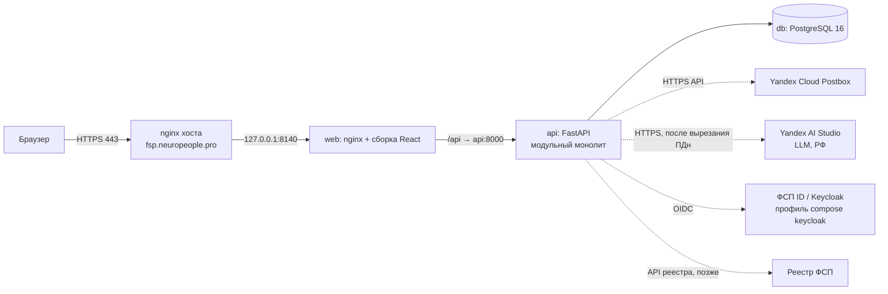
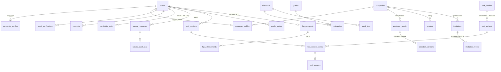

# Архитектура платформы «Встречный» (спецтрек ФСП)

Документ отвечает п. 3.4 ТЗ в части функциональной и компонентной архитектуры, модели данных,
разделения слоёв и схемы интеграции с ФСП ID. Механики тестирования, подбора и процедура валидации
описываются в отдельных документах по мере реализации (дни 2–6). Версия: 0.2 (05.10.2026, день 2).

## 1. Принципы

1. **Категория — только по подтверждённым фактам.** Опрос и резюме дают факты уровня T0, тест и зонд — T1,
   реестр ФСП — T2. Категоризация и ранжирование используют только T1/T2.
2. **Инициатива у работодателя.** Центральный сценарий — «подборка с объяснением → (зонд) → приглашение
   с вилкой → принятие → раскрытие контактов», а не отклик кандидата.
3. **Проверяемость важнее «умности».** Задания строятся из семейств проверенных шаблонов с генератором по seed;
   результаты воспроизводимы; валидация встроена в прототип (`make validate`, страница валидации).
4. **Приватность по умолчанию (152-ФЗ).** Контакты закрыты до принятия приглашения; минимум зарплаты кандидата
   скрыт; ПДн вырезаются локально до отправки текста в LLM.
5. **Простота эксплуатации.** Модульный монолит, три контейнера, бюджет памяти ≤ 1,5 ГБ.

## 2. Функциональная архитектура

### 2.1. Роли

| Роль | Что делает |
|---|---|
| Кандидат | Регистрация и подтверждение почты, опрос, выбор грейда, тест, категория и рейтинг, приглашения и зонды, паспорт ФСП, приватность |
| Работодатель | Профиль компании, потребность текстом, подборка с объяснением, поиск по базе, зонд, приглашение-оффер, статусы |
| ФСП (внешняя система) | ФСП ID (Keycloak, OIDC) и реестр достижений — источник фактов T2 |
| Жюри | Демо-режим «песочница» (снятие ограничения 90 дней), страница валидации |

### 2.2. Функциональные блоки → модули backend

| Блок | Модуль | Ключевые функции | Статус (день 2) |
|---|---|---|---|
| Учётные записи | `auth` | регистрация по почте, код подтверждения, вход (JWT), согласия 152-ФЗ | готово |
| Справочник | `catalog` | 5 направлений × 3 грейда = 15 категорий, рыночные диапазоны, стек-теги, дисциплины ЕВСК | готово |
| Профили | `profiles` | опрос, видимость полей, согласия, обезличенная карточка (`C-XXXXXX`), факты T0/T1/T2 | готово |
| Тестирование | `assessment` | адаптивный тест на банке заданий (`BankEngine`), дотестирование у порога, детектор предзнания, оценка открытых ответов по рубрике (LLM / «на проверке»), грейд, история, правило 90 дней, демо-режим жюри | готово |
| Подбор | `matching` | потребность → требования (LLM + словарь), подборка с объяснением, версии подборок, поиск | готово |
| Контакт | `invitations` | зонд (вилка), приглашение-оффер, статусы и история, раскрытие контактов, лимит 30 дней | готово |
| ФСП | `fsp` | паспорт достижений по ЕВСК, связь с ФСП ID (заглушка), бонус в рейтинге, нейтральное «нет истории» | заглушка + демо-паспорта |
| Валидация | `validation` | precision@k, стабильность грейда, дискриминативность, устойчивость к утечке | заготовка `make validate` |
| Документы | `resume`, `pdf` | разбор PDF-резюме (pypdf), вырезание ПДн (Natasha + регулярные выражения), PDF-профиль (ReportLab) | готово |
| LLM | `llm` | OpenAI-совместимый клиент (Yandex AI Studio), таймауты, запасной путь без LLM | готово |
| Демо | `demo` | 150 кандидатов, 10 работодателей, 15 потребностей (`is_demo`) | готово |
| Уведомления | `notifications` | адаптер почты: DevMailer (лог) / Postbox (HTTPS API) | готово |

### 2.3. Сквозной сценарий (целевой)

```mermaid
sequenceDiagram
  actor C as Кандидат
  actor E as Работодатель
  participant P as Платформа
  C->>P: Регистрация, код из письма
  C->>P: Опрос (направление, стек) и выбор грейда
  P->>C: Тест: варианты из семейств заданий
  P->>P: Оценка → категория «направление · грейд», факты T1, рейтинг
  E->>P: Профиль компании, потребность текстом
  P->>E: Подборка: категории и обезличенные кандидаты + «почему» (T1/T2)
  opt Зонд
    E->>P: Короткая задача с вилкой зарплаты
    P->>C: Зонд (15 минут)
    C->>P: Решение или подход
  end
  E->>P: Приглашение: вилка «от–до» ₽, компания, суть, способ связи
  P->>C: Входящее приглашение
  C->>P: Принять / отклонить
  P->>E: Статус; при принятии — контакты кандидата
```

## 3. Компонентная архитектура



| Компонент | Технология | Память (лимит) | Порт |
|---|---|---|---|
| web | nginx 1.27 + статика Vite | 96 МБ | 127.0.0.1:8140 → 80 |
| api | Python 3.12, FastAPI, uvicorn (2 воркера), Natasha, ReportLab | 896 МБ | 127.0.0.1:8141 → 8000 |
| db | PostgreSQL 16 (shared_buffers 128 МБ) | 512 МБ | только внутренняя сеть compose |
| keycloak (выкл.) | Keycloak 26, `start-dev` | 768 МБ | 127.0.0.1:8142 (профиль `keycloak`) |

Итого лимиты стека: 96 + 896 + 512 = 1504 МБ ≈ 1,5 ГБ (фактически api ≈ 170 МБ, Natasha загружается лениво).

Миграции Alembic применяются при старте контейнера api. OpenAPI: `/api/docs` (Swagger UI), `/api/redoc`,
`/api/openapi.json`; файлы Swagger UI 5.33.1 и ReDoc 2.5.4 раздаются с нашего сервера (`/api/static/apidocs`),
внешние CDN не используются.

## 4. Разделение слоёв (backend)

```
app/
  core/            конфигурация, БД (Base, сессии), безопасность (argon2, JWT, коды), зависимости, ошибки, перечисления
  modules/<name>/
    models.py      слой хранения (SQLAlchemy 2, только свои таблицы)
    schemas.py     контракты API (Pydantic v2)
    service.py     бизнес-логика (без HTTP)
    router.py      HTTP-слой (FastAPI): валидация, коды ошибок, OpenAPI
  models.py        единая metadata для Alembic
assessment_bank/   копия пакета банка заданий (чистый Python без БД и без сети); обновляется tools/sync_bank.py
migrations/        Alembic (0001 — ядро схемы, 0002 — справочник)
```

Правила: роутер вызывает только сервис своего модуля; модули общаются через сервисы, а не через чужие роутеры;
внешние системы (почта, LLM, ФСП, тест) — только через адаптеры (`notifications.mailer`, `llm.client`,
`assessment.engine`, будущий `fsp.client`).
Код кандидатов на сервере не исполняется: форматы заданий — «найди ошибку», «предскажи вывод», «выбери исправление»,
«открытая книга в 3 шага», концептуальный выбор, открытый ответ по рубрике.

Ошибки API: `{"detail": {"code": "<машинный код>", "message": "<текст по-русски>"}}`; коды задокументированы в OpenAPI.

## 5. Модель данных

Перечисления хранятся как VARCHAR + CHECK (переносимо PostgreSQL ↔ SQLite для тестов), JSON-поля — JSONB в PostgreSQL.
Имена ограничений задаются единым соглашением (`pk_`, `fk_`, `uq_`, `ck_`, `ix_`).



| Группа | Таблицы | Важные правила в схеме |
|---|---|---|
| Учётные записи | `users`, `email_verifications`, `consents` | почта уникальна (в нижнем регистре); пароль — argon2id; код хранится как HMAC, ≤5 попыток, 15 мин; `token_version` отзывает JWT; `fsp_subject` — sub из ФСП ID |
| Справочник | `directions`, `grades`, `categories`, `stack_tags` | 5×3 категорий, `market_salary_from ≤ market_salary_to`; стек с `direction_id = NULL` — общий блок |
| Профили | `candidate_profiles`, `companies`, `employer_profiles`, `candidate_facts` | `salary_min_hidden` не отдаётся работодателю; текущая категория ставится только по тесту; `candidate_facts.evidence_level ∈ {T0,T1,T2}` |
| Тестирование | `survey_responses`, `survey_stack_tags`, `task_families`, `task_variants`, `test_sessions`, `test_session_items`, `test_answers`, `grade_history` | вариант = `family_id:seed` (уникален); ключ ответа только на сервере; `form_seed` сессии для воспроизводимости; канареечные семейства и карантин по экспозиции; история грейда с `locked_until` (90 дней, кроме песочницы) |
| Подбор | `employer_needs`, `selection_versions` | уточнение фильтров создаёт новую версию (`need_id, version` уникальны) — прежняя подборка не теряется |
| Контакт | `probes`, `invitations`, `invitation_events` | вилка обязательна: `salary_from > 0 AND salary_from ≤ salary_to`; индекс пары «компания — кандидат — дата» для правила 30 дней; статусы sent → viewed → accepted/declined/withdrawn/expired и журнал переходов; `contacts_revealed_at` |
| ФСП | `fsp_passports`, `fsp_achievements` | дисциплина по ЕВСК, уровень мероприятия, место, `verified` (T2); нет паспорта — нейтральное состояние |

## 6. Безопасность и 152-ФЗ

- Пароли — argon2id (`argon2-cffi`), прозрачный rehash при смене параметров. JWT HS256, срок 12 ч, `iss`, `ver`.
- Коды подтверждения: 6 цифр, `secrets`, хранится только HMAC-SHA256; лимит попыток и частоты повторной отправки;
  повторная отправка не раскрывает, зарегистрирован ли адрес; выравнивание времени ответа при входе.
- Согласие на обработку ПДн обязательно при регистрации и фиксируется с версией документа (`consents`).
- Разграничение по ролям (`require_role`), кандидат видит только свои записи; контакты кандидата — после принятия.
- ПДн (ФИО, почта, телефон, ники, ссылки на профили, дата рождения, СНИЛС) вырезаются на нашем сервере (Natasha, MIT,
  + регулярные выражения) до отправки текста в LLM; найденные значения в БД не сохраняются, исходный PDF не хранится.
- Работодатель видит обезличенную карточку (`C-XXXXXX`); контакты — только после принятия приглашения; скрытый минимум
  зарплаты кандидата не показывается никогда (работодателю — рыночный диапазон категории).
- Согласие на публикацию профиля отзывается в один клик — профиль сразу исчезает из подборок и поиска.
- Порты контейнеров — только 127.0.0.1; TLS на nginx хоста; секреты в `.env` и `secrets/` (вне git).

## 7. Интеграция с ФСП ID (Keycloak) и реестром ФСП

ТЗ: «ФСП ID будет работать на базе Keycloak»; API и структура данных ФСП не предоставляются. Решение — стандартный
OIDC, без привязки к особенностям конкретной инсталляции.

### 7.1. Связка аккаунта (MVP+)

```mermaid
sequenceDiagram
  actor C as Кандидат
  participant W as web
  participant A as api
  participant K as ФСП ID (Keycloak, realm fsp)
  participant R as Реестр ФСП
  C->>W: «Связать с ФСП ID»
  W->>A: GET /api/fsp/oidc/start
  A->>W: redirect: /realms/fsp/protocol/openid-connect/auth (code + PKCE, state, nonce)
  W->>K: вход участника ФСП
  K->>A: GET /api/fsp/oidc/callback?code=…&state=…
  A->>K: POST /token (code_verifier) → id_token, access_token
  A->>A: проверка подписи по JWKS, iss, aud, nonce
  A->>A: users.fsp_subject = sub; fsp_passports(link_source=keycloak)
  A->>R: запрос достижений по sub (сервисный клиент, client_credentials)
  R-->>A: дисциплина ЕВСК, мероприятие, уровень, дата, место, разряд
  A->>A: fsp_achievements(verified=true) → candidate_facts(T2)
```

- Конфигурация: `FSP_OIDC_ISSUER` (`https://<host>/realms/fsp`), `FSP_OIDC_CLIENT_ID`; конфиденциальный клиент
  с Authorization Code + PKCE; discovery — `/.well-known/openid-configuration`.
- Минимум данных: `sub` (обязательно), `email` (для сверки). ФИО из ФСП не требуется — приватность.
- Без ФСП ID или без достижений — паспорт отсутствует, это нейтральное состояние (без штрафа в рейтинге).
- На хакатоне реестр недоступен: паспорт заполняется демо-данными (`link_source=demo`, факты T1-демо помечаются явно).

### 7.2. Вход через ФСП ID (после хакатона)

Keycloak может стать основным провайдером входа: API принимает токены Keycloak (проверка по JWKS), роли
`candidate`/`employer` — роли realm; собственный JWT остаётся для пользователей вне ФСП. Таблица `users`
уже содержит `fsp_subject` для сопоставления. Для проверки совместимости — `docker compose --profile keycloak up -d keycloak`.

## 8. Банк заданий (формат)

Пакет `assessment_bank` (чистый Python, без БД). Семейство = YAML-описание + генератор `generate(seed) -> Variant`.
Поля семейства: `family_id`, `direction` (common|backend|frontend|data_ml|qa|security), `skills[]`, `target_grades[]`,
`format` (find_bug | predict_output | choose_fix | open_book_3step | mcq_concept | open_answer), `invariants`,
`time_limit_s`, `canary`, `prior_difficulty`. Variant: `variant_id` (family_id + seed), `stem`, `code`, `options`,
`answer_key`, `rubric`, `meta`. В БД — таблицы `task_families` и `task_variants`; валидатор проверяет детерминизм,
инварианты, уникальность и разнообразие вариантов.

### 8.1. Точка интеграции сервиса тестирования

Бэкенд работает с тестом только через протокол `AssessmentEngine` (`backend/app/modules/assessment/engine.py`):

| Метод | Вход | Выход |
|---|---|---|
| `start` | направление, заявленный грейд, стек-теги, seed | состояние сессии (JSON, хранится в `test_sessions.result.state`) |
| `next_item` | состояние | `ItemPublic` (без ключа и рубрики) или `None` |
| `answer` | состояние, `item_id`, ответ, время | `AnswerFeedback` (принят, отвечено, всего, завершён) |
| `finish` | состояние | `EngineResult`: θ, SE, точечный грейд, подтверждён ли заявленный, P(грейд), навыки по стеку |

Рабочий движок — `BankEngine` (`app/modules/assessment/bank_engine.py`, `ASSESSMENT_ENGINE=bank`); заглушка
`StubEngine` (6 вопросов, Раш + EAP) остаётся запасным путём: если пакет банка не загрузился, API стартует на ней
и пишет ошибку в лог. Правила грейда (90 дней, «не понижать при неудаче», демо-режим жюри) — в
`assessment/rules.py`, вне движка.

### 8.2. Сессия теста на банке

- **Состав.** Общий блок (≈ 40 %) + блок направления; выбор следующего семейства — максимум информации в текущей θ
  (`psychometrics.CATSession`, IRT по частям задания). Канарейки — на позициях 2, 6, 10, в θ не входят.
- **Остановка.** SE ≤ 0,35 при 8–20 заданиях, лимит 90 минут или исчерпание пула. Если |θ − порог заявленного
  грейда| < SE — дотестирование: ещё 3–4 задания, выбранных по информации в самом пороге (один раз).
- **Решение.** `psychometrics.decide`: подтверждён, если P(уровень ≥ заявленного) ≥ 0,8; «можно выше» при
  P(следующий) ≥ 0,9; принудительного понижения нет. Досрочно завершить тест нельзя (`409 test_not_complete`).
- **Скрытие ключей.** Кандидату уходят только stem, код и варианты текущего шага. `item_id` — случайный токен;
  `family_id`, `variant_id`, seed, ключ и рубрика остаются в состоянии сессии и в БД. Seed рабочих вариантов —
  из криптостойкого ГСЧ (~2·10⁹ значений): генераторы открыты (MIT), но перебрать варианты заранее нельзя.
- **Форматы.** `find_bug` — выбор строки; `predict_output` — текст, сверка после `metrics.normalize_output`;
  `choose_fix`, `mcq_concept` — вариант A–F; `open_book_3step` — три шага по очереди (воспроизвести, исправить —
  варианты; объяснить — текст); `open_answer` — текст. Код кандидатов не исполняется.
- **Время.** Сервер фиксирует момент показа и каждого ответа (по шагам), клиентское время хранится справочно.
  log T идёт в модель времени детектора предзнания (`CanaryDetector`: скорость на канарейках + «быстро и верно»).
  При срабатывании θ пересчитывается без подозрительных ответов; факт виден в данных сессии, не кандидату.
- **Хранение.** Состояние — JSON `test_sessions.result.state` (CATSession пересобирается на каждом запросе,
  строка сессии блокируется `SELECT … FOR UPDATE`). Нормализованная копия — `task_families`, `task_variants`,
  `test_session_items`, `test_answers` (ответ, баллы по частям, время) — для калибровки банка и аудита.
- **Экспозиция.** Ограничение Sympson–Hetter выключено: банк пока мал (≈ 100 семейств), уникальность обеспечивают
  случайные seed вариантов. Ротация субпулов — `ASSESSMENT_SUBPOOLS` (по умолчанию 1, т. е. выключена).
- **Пополнение банка.** Пакет `../bank` не изменяется; `tools/sync_bank.py` (вызывается из скрипта выкладки) копирует
  его в `backend/assessment_bank`, прогоняет валидатор банка и проверку генерации/`public_view`, исключает
  семейства с ошибками и пишет манифест `BANK_SYNC.json` (коммит источника, хэш содержимого, состав, исключения).
  Новые семейства попадают в тест при следующей выкладке; версия банка — в имени движка `bank-<хэш>`.

## 9. API (на 05.10.2026, день 2)

| Метод | Путь | Назначение | Ошибки |
|---|---|---|---|
| GET | `/api/health` | состояние API и БД, режим почты | — |
| POST | `/api/auth/register` | регистрация (candidate/employer), согласие ПДн; в DEV_MODE — код в ответе | 409, 422 |
| POST | `/api/auth/verify-email` | подтверждение почты кодом → JWT | 400, 429 |
| POST | `/api/auth/resend-code` | повторная отправка кода | 429 |
| POST | `/api/auth/login` | вход (JSON) → JWT | 401, 403 |
| POST | `/api/auth/token` | вход формой OAuth2 (Swagger Authorize) | 401, 403 |
| GET | `/api/me` | текущий пользователь, профиль, статус ФСП | 401 |
| PATCH | `/api/me/candidate-profile` | обновление профиля кандидата | 401, 403 |
| PATCH | `/api/me/company` | обновление компании работодателя | 401, 403, 404 |
| GET | `/api/catalog` | направления, грейды, категории, стек, дисциплины ЕВСК | — |
| GET | `/api/catalog/stack-tags?direction=` | стек для опроса (с общим блоком) | — |
| GET/PUT | `/api/me/onboarding` | опрос: направление, стек, стаж, роли, формат, город, скрытый минимум, видимость, согласие | 401, 403, 422 |
| PUT | `/api/me/privacy`, `/api/me/jury-mode` | видимость полей карточки; демо-режим жюри (снятие правила 90 дней) | 401, 403 |
| GET/POST/DELETE | `/api/me/consents[/{kind}]`, `/api/legal/consents/{kind}` | согласия 152-ФЗ и их тексты | 401, 404 |
| POST | `/api/assessment/sessions` → GET `/{id}` → POST `/{id}/answers` → `/{id}/finish` | адаптивный тест на заявленный грейд: задание без ключа, ответ (вариант / строка / текст, шаг), θ, SE, категория | 401, 403, 409, 422, 423 |
| GET | `/api/assessment/status` | категория и грейд, история, правило 90 дней | 401, 403 |
| POST/GET | `/api/me/resume`, `/api/me/resume/{id}/apply` | PDF-резюме: текст без ПДн, поля T0 | 401, 413, 415, 422 |
| GET | `/api/me/card`, `/api/me/profile.pdf`, `/api/me/fsp`, POST `/api/me/fsp/link` | карточка, PDF-профиль, паспорт ФСП | 401, 403 |
| POST | `/api/employer/needs/parse`, `/api/employer/needs` | потребность текстом → требования → подборка v1 | 401, 403, 422 |
| GET/POST | `/api/employer/needs/{id}/selections[/{v}]` | версии подборок: категории, карточки, объяснения | 401, 403, 404, 422 |
| GET | `/api/employer/candidates`, `/api/employer/candidates/{ref}[/profile.pdf]`, `/api/employer/categories` | поиск по базе, карточка, PDF | 401, 403, 404 |
| POST/GET | `/api/employer/probes`, `/{id}/review`; `/api/candidate/probes`, `/{id}/answer`, `/{id}/decline` | зонды | 401, 403, 404, 409, 422 |
| POST/GET | `/api/employer/invitations`, `/{id}/withdraw`; `/api/candidate/invitations`, `/{id}/accept`, `/{id}/decline` | приглашения, статусы, история | 401, 403, 404, 409, 422 |
| GET | `/api/meta` | название продукта, оператор ПДн, LLM, движок теста | — |

Полный список с кодами ошибок — `/api/docs`.

## 10. Библиотеки и версии

| Компонент | Версия | Лицензия |
|---|---|---|
| Python | 3.12 | PSF |
| FastAPI | 0.142.2 | MIT |
| uvicorn | 0.54.0 | BSD-3 |
| SQLAlchemy | 2.1.3 | MIT |
| Alembic | 1.20.0 | MIT |
| Pydantic / pydantic-settings | 2.13.5 / 2.15.0 | MIT |
| argon2-cffi | 25.1.0 | MIT |
| PyJWT | 2.15.1 | MIT |
| psycopg | 3.3.6 | LGPL-3.0 |
| boto3 (Postbox SESv2) | 1.43.108 | Apache-2.0 |
| PyYAML | 6.0.3 | MIT |
| pytest / httpx | 9.1.1 / 0.28.1 | MIT / BSD-3 |
| pypdf / ReportLab | 6.19.0 / 5.0.1 | BSD-3 / BSD-3 |
| Natasha (NER) | 1.6.0 | MIT |
| NumPy / SciPy (движок теста) | 2.1.3 / 1.14.1 | BSD-3 / BSD-3 |
| assessment_bank (банк заданий, копия) | см. `backend/assessment_bank/BANK_SYNC.json` | MIT |
| Swagger UI / ReDoc (локально) | 5.33.1 / 2.5.4 | Apache-2.0 / MIT |
| PostgreSQL | 16 (alpine) | PostgreSQL |
| React / React Router | 18.3 / 6.30 | MIT |
| Vite / TypeScript | 5.4 / 5.9 | MIT / Apache-2.0 |
| Tailwind CSS | 3.4 | MIT |
| Montserrat (@fontsource) | 5.x | OFL-1.1 |
| nginx | 1.27 (alpine) | BSD-2 |
| Keycloak (опционально) | 26.0 | Apache-2.0 |

## 11. Развёртывание

Сервер: `/opt/git/spectrek_fsp.git` (голый репозиторий) → рабочая копия `/opt/spectrek_fsp/app` →
`docker compose up -d --build`. Секреты: `/opt/spectrek_fsp/app/.env` (права 600), ключи почты —
`/opt/spectrek_fsp/secrets/postbox.env` (подключается как `env_file`). nginx хоста — отдельный файл сайта:

```nginx
server {
    listen 443 ssl;
    server_name fsp.neuropeople.pro;
    ssl_certificate     /etc/letsencrypt/live/fsp.neuropeople.pro/fullchain.pem;
    ssl_certificate_key /etc/letsencrypt/live/fsp.neuropeople.pro/privkey.pem;
    location / { proxy_pass http://127.0.0.1:8140; proxy_set_header Host $host;
                 proxy_set_header X-Forwarded-Proto $scheme; }
}
```

Сертификат: `certbot certonly --webroot -w /opt/spectrek_fsp/acme -d fsp.neuropeople.pro --deploy-hook "systemctl reload nginx"`.

## 12. LLM-слой

- Провайдер: **Yandex AI Studio** (`https://llm.api.cloud.yandex.net/v1`, OpenAI-совместимый API), модель
  `yandexgpt/latest`; модели размещены в Yandex Cloud в РФ — данные не покидают РФ.
- Клиент `app/modules/llm/client.py` провайдер-агностичный: `LLM_PROVIDER=yandex_ai_studio` добавляет заголовки
  `Authorization: Api-Key …` и `OpenAI-Project: <каталог>`; для любого другого OpenAI-совместимого — `Bearer`.
  Ответ моделей с рассуждениями читается и из `reasoning_content`. Таймаут 25 с (подключение 5 с), ключ в логи не пишется.
- Секреты: `/opt/spectrek_fsp/secrets/llm.env` подключается как `env_file` сервиса api (`LLM_ENV_FILE`).
- Перед отправкой текст проходит вырезание ПДн; в LLM уходит только обезличенный текст.
- У каждой функции есть детерминированный путь без LLM: разбор потребности и резюме — словарь стек-тегов (алиасы
  RU/EN), правила для грейда, стажа, формата, вилки. LLM лишь дополняет результат (`method: llm+rules`), значения
  проверяются по справочнику. `LLM_DISABLED=true` или недоступность провайдера → `method: rules`.
- Открытые ответы теста (`assessment/grader.py`): рубрика банка (критерии с весами + эталоны сильного/среднего/
  слабого ответа) → оценка 0..1 по каждому критерию, итог — взвешенная сумма. Ответ вырезается от ПДн и передаётся
  как данные между маркерами (инструкции внутри не выполняются). Пустой/очень короткий ответ — 0 без LLM.
  Нет LLM или ответ невалиден → статус «на проверке»: в θ не входит, повторная попытка при завершении теста,
  в результате — пометка «предварительный». Модель — `LLM_GRADING_MODEL` (по умолчанию `LLM_MODEL`), таймаут 40 с.
- Выбор модели оценщика — по согласию с экспертами на проверочном наборе. Предварительная проверка 05.10 на сервере
  (3 семейства × эталоны strong/medium/weak + попытка инъекции): обе модели дают порядок strong 1,0 > medium > weak 0,
  инъекция — 0. `yandexgpt/latest`: medium 0,85 / 0,70 / 0,38, в среднем 1,9 с; `gpt-oss-120b/latest`: medium
  0,35 / 0,50 / 0,38, в среднем 3,6 с (до 6,8 с). Пока оставлен `yandexgpt/latest` (быстрее, ответ оценивается в
  момент отправки); `gpt-oss-120b` строже к средним ответам — кандидат на итоговый выбор после сверки с экспертами.

## 13. Подбор и ранжирование (match-v1)

```
score = 0,45·тест (T1) + 0,35·обязательный стек, подтверждённый заданиями (T1) + 0,05·желательный стек (T1)
      + 0,10·паспорт ФСП (T2, нет истории — 0 без штрафа) + 0,05·зонды (T1)
```

- Пул — только видимые кандидаты с категорией; категории: точная, соседние грейды, всё направление.
- Самоописание (T0: стек из опроса/резюме, стаж, формат, город) — только фильтр и пометка «заявлено», на скор не влияет.
- Объяснение по каждому требованию: уровень (T2/T1/T0/нет данных), статус (подтверждено, заявлено, нет, частично).
- Уточнение создаёт новую версию подборки (`parent_version`), прежние версии не меняются.

## 14. Контакт

- Зонд: короткая задача с обязательной вилкой «от–до», ответ решением или подходом (код не исполняется),
  оценка работодателя (сильное/хорошее/слабое) становится фактом T1.
- Приглашение: позиция, суть, вилка «от–до» ₽ (обязательна, от ≤ до), способ связи, автоматически приложенные факты
  T1/T2. Статусы `sent → viewed → accepted | declined | withdrawn` с историей у обеих сторон; причина отказа необязательна.
- Лимит: одно приглашение кандидату от компании за 30 дней (409 `invitation_cooldown`).
- Контакты кандидата раскрываются работодателю только после `accepted`; письма — через почтовый адаптер (Postbox).
