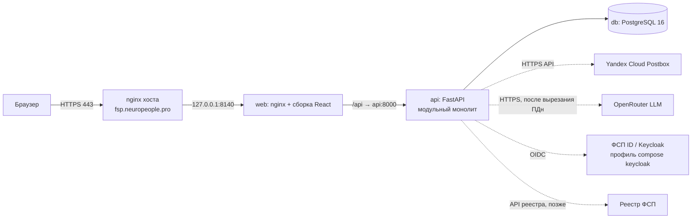
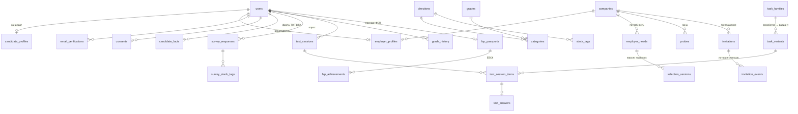

# Архитектура платформы «Встречный» (спецтрек ФСП)

Документ отвечает п. 3.4 ТЗ в части функциональной и компонентной архитектуры, модели данных,
разделения слоёв и схемы интеграции с ФСП ID. Механики тестирования, подбора и процедура валидации
описываются в отдельных документах по мере реализации (дни 2–6). Версия: 0.1 (05.10.2026).

## 1. Принципы

1. **Категория — только по подтверждённым фактам.** Опрос и резюме дают факты уровня T0, тест и зонд — T1,
   реестр ФСП — T2. Категоризация и ранжирование используют только T1/T2.
2. **Инициатива у работодателя.** Центральный сценарий — «подборка с объяснением → (зонд) → приглашение
   с вилкой → принятие → раскрытие контактов», а не отклик кандидата.
3. **Проверяемость важнее «умности».** Задания строятся из семейств проверенных шаблонов с генератором по seed;
   результаты воспроизводимы; валидация встроена в прототип (`make validate`, страница валидации).
4. **Приватность по умолчанию (152-ФЗ).** Контакты закрыты до принятия приглашения; минимум зарплаты кандидата
   скрыт; ПДн вырезаются локально до отправки текста в LLM.
5. **Простота эксплуатации.** Модульный монолит, три контейнера, бюджет памяти ≤ 1,5 ГБ.

## 2. Функциональная архитектура

### 2.1. Роли

| Роль | Что делает |
|---|---|
| Кандидат | Регистрация и подтверждение почты, опрос, выбор грейда, тест, категория и рейтинг, приглашения и зонды, паспорт ФСП, приватность |
| Работодатель | Профиль компании, потребность текстом, подборка с объяснением, поиск по базе, зонд, приглашение-оффер, статусы |
| ФСП (внешняя система) | ФСП ID (Keycloak, OIDC) и реестр достижений — источник фактов T2 |
| Жюри | Демо-режим «песочница» (снятие ограничения 90 дней), страница валидации |

### 2.2. Функциональные блоки → модули backend

| Блок | Модуль | Ключевые функции | Статус 05.10 |
|---|---|---|---|
| Учётные записи | `auth` | регистрация по почте, код подтверждения, вход (JWT), согласия 152-ФЗ | готово |
| Справочник | `catalog` | 5 направлений × 3 грейда = 15 категорий, рыночные диапазоны, стек-теги, дисциплины ЕВСК | готово |
| Профили | `profiles` | профиль «я», профиль кандидата, компания, факты T0/T1/T2 | готово (базово) |
| Тестирование | `assessment` | опрос, банк заданий (семейство/вариант), сборка формы, сессия, ответы, грейд и история | схема БД |
| Подбор | `matching` | потребность → структурированные требования → подборка с объяснением, версии подборок | схема БД |
| Контакт | `invitations` | зонд (15 мин, вилка), приглашение-оффер, статусы и история, раскрытие контактов, лимит 30 дней | схема БД |
| ФСП | `fsp` | паспорт достижений по ЕВСК, связь с ФСП ID, бонус в рейтинге, нейтральное «нет истории» | схема БД |
| Валидация | `validation` | precision@k, стабильность грейда, дискриминативность, устойчивость к утечке | заготовка `make validate` |
| Документы | `pdf` | разбор PDF-резюме, стандартизированный PDF-профиль | план |
| Уведомления | `notifications` | адаптер почты: DevMailer (лог) / Postbox (HTTPS API) | готово |

### 2.3. Сквозной сценарий (целевой)

```mermaid
sequenceDiagram
  actor C as Кандидат
  actor E as Работодатель
  participant P as Платформа
  C->>P: Регистрация, код из письма
  C->>P: Опрос (направление, стек) и выбор грейда
  P->>C: Тест: варианты из семейств заданий
  P->>P: Оценка → категория «направление · грейд», факты T1, рейтинг
  E->>P: Профиль компании, потребность текстом
  P->>E: Подборка: категории и обезличенные кандидаты + «почему» (T1/T2)
  opt Зонд
    E->>P: Короткая задача с вилкой зарплаты
    P->>C: Зонд (15 минут)
    C->>P: Решение или подход
  end
  E->>P: Приглашение: вилка «от–до» ₽, компания, суть, способ связи
  P->>C: Входящее приглашение
  C->>P: Принять / отклонить
  P->>E: Статус; при принятии — контакты кандидата
```

## 3. Компонентная архитектура



| Компонент | Технология | Память (лимит) | Порт |
|---|---|---|---|
| web | nginx 1.27 + статика Vite | 96 МБ | 127.0.0.1:8140 → 80 |
| api | Python 3.12, FastAPI, uvicorn (2 воркера) | 512 МБ | 127.0.0.1:8141 → 8000 |
| db | PostgreSQL 16 (shared_buffers 128 МБ) | 512 МБ | только внутренняя сеть compose |
| keycloak (выкл.) | Keycloak 26, `start-dev` | 768 МБ | 127.0.0.1:8142 (профиль `keycloak`) |

Миграции Alembic применяются при старте контейнера api. OpenAPI: `/api/docs`, `/api/redoc`, `/api/openapi.json`.

## 4. Разделение слоёв (backend)

```
app/
  core/            конфигурация, БД (Base, сессии), безопасность (argon2, JWT, коды), зависимости, ошибки, перечисления
  modules/<name>/
    models.py      слой хранения (SQLAlchemy 2, только свои таблицы)
    schemas.py     контракты API (Pydantic v2)
    service.py     бизнес-логика (без HTTP)
    router.py      HTTP-слой (FastAPI): валидация, коды ошибок, OpenAPI
  models.py        единая metadata для Alembic
assessment_bank/   банк заданий: чистый Python без БД и без сети
migrations/        Alembic (0001 — ядро схемы, 0002 — справочник)
```

Правила: роутер вызывает только сервис своего модуля; модули общаются через сервисы, а не через чужие роутеры;
внешние системы (почта, LLM, ФСП) — только через адаптеры (`notifications.mailer`, будущие `fsp.client`, `llm`).
Код кандидатов на сервере не исполняется: форматы заданий — «найди ошибку», «предскажи вывод», «выбери исправление»,
«открытая книга в 3 шага», концептуальный выбор, открытый ответ по рубрике.

Ошибки API: `{"detail": {"code": "<машинный код>", "message": "<текст по-русски>"}}`; коды задокументированы в OpenAPI.

## 5. Модель данных

Перечисления хранятся как VARCHAR + CHECK (переносимо PostgreSQL ↔ SQLite для тестов), JSON-поля — JSONB в PostgreSQL.
Имена ограничений задаются единым соглашением (`pk_`, `fk_`, `uq_`, `ck_`, `ix_`).



| Группа | Таблицы | Важные правила в схеме |
|---|---|---|
| Учётные записи | `users`, `email_verifications`, `consents` | почта уникальна (в нижнем регистре); пароль — argon2id; код хранится как HMAC, ≤5 попыток, 15 мин; `token_version` отзывает JWT; `fsp_subject` — sub из ФСП ID |
| Справочник | `directions`, `grades`, `categories`, `stack_tags` | 5×3 категорий, `market_salary_from ≤ market_salary_to`; стек с `direction_id = NULL` — общий блок |
| Профили | `candidate_profiles`, `companies`, `employer_profiles`, `candidate_facts` | `salary_min_hidden` не отдаётся работодателю; текущая категория ставится только по тесту; `candidate_facts.evidence_level ∈ {T0,T1,T2}` |
| Тестирование | `survey_responses`, `survey_stack_tags`, `task_families`, `task_variants`, `test_sessions`, `test_session_items`, `test_answers`, `grade_history` | вариант = `family_id:seed` (уникален); ключ ответа только на сервере; `form_seed` сессии для воспроизводимости; канареечные семейства и карантин по экспозиции; история грейда с `locked_until` (90 дней, кроме песочницы) |
| Подбор | `employer_needs`, `selection_versions` | уточнение фильтров создаёт новую версию (`need_id, version` уникальны) — прежняя подборка не теряется |
| Контакт | `probes`, `invitations`, `invitation_events` | вилка обязательна: `salary_from > 0 AND salary_from ≤ salary_to`; индекс пары «компания — кандидат — дата» для правила 30 дней; статусы sent → viewed → accepted/declined/withdrawn/expired и журнал переходов; `contacts_revealed_at` |
| ФСП | `fsp_passports`, `fsp_achievements` | дисциплина по ЕВСК, уровень мероприятия, место, `verified` (T2); нет паспорта — нейтральное состояние |

## 6. Безопасность и 152-ФЗ

- Пароли — argon2id (`argon2-cffi`), прозрачный rehash при смене параметров. JWT HS256, срок 12 ч, `iss`, `ver`.
- Коды подтверждения: 6 цифр, `secrets`, хранится только HMAC-SHA256; лимит попыток и частоты повторной отправки;
  повторная отправка не раскрывает, зарегистрирован ли адрес; выравнивание времени ответа при входе.
- Согласие на обработку ПДн обязательно при регистрации и фиксируется с версией документа (`consents`).
- Разграничение по ролям (`require_role`), кандидат видит только свои записи; контакты кандидата — после принятия.
- ПДн (ФИО, контакты) вырезаются локально (Natasha, MIT) до отправки текста в LLM; ключ OpenRouter — только из окружения.
- Порты контейнеров — только 127.0.0.1; TLS на nginx хоста; секреты в `.env` и `secrets/` (вне git).

## 7. Интеграция с ФСП ID (Keycloak) и реестром ФСП

ТЗ: «ФСП ID будет работать на базе Keycloak»; API и структура данных ФСП не предоставляются. Решение — стандартный
OIDC, без привязки к особенностям конкретной инсталляции.

### 7.1. Связка аккаунта (MVP+)

```mermaid
sequenceDiagram
  actor C as Кандидат
  participant W as web
  participant A as api
  participant K as ФСП ID (Keycloak, realm fsp)
  participant R as Реестр ФСП
  C->>W: «Связать с ФСП ID»
  W->>A: GET /api/fsp/oidc/start
  A->>W: redirect: /realms/fsp/protocol/openid-connect/auth (code + PKCE, state, nonce)
  W->>K: вход участника ФСП
  K->>A: GET /api/fsp/oidc/callback?code=…&state=…
  A->>K: POST /token (code_verifier) → id_token, access_token
  A->>A: проверка подписи по JWKS, iss, aud, nonce
  A->>A: users.fsp_subject = sub; fsp_passports(link_source=keycloak)
  A->>R: запрос достижений по sub (сервисный клиент, client_credentials)
  R-->>A: дисциплина ЕВСК, мероприятие, уровень, дата, место, разряд
  A->>A: fsp_achievements(verified=true) → candidate_facts(T2)
```

- Конфигурация: `FSP_OIDC_ISSUER` (`https://<host>/realms/fsp`), `FSP_OIDC_CLIENT_ID`; конфиденциальный клиент
  с Authorization Code + PKCE; discovery — `/.well-known/openid-configuration`.
- Минимум данных: `sub` (обязательно), `email` (для сверки). ФИО из ФСП не требуется — приватность.
- Без ФСП ID или без достижений — паспорт отсутствует, это нейтральное состояние (без штрафа в рейтинге).
- На хакатоне реестр недоступен: паспорт заполняется демо-данными (`link_source=demo`, факты T1-демо помечаются явно).

### 7.2. Вход через ФСП ID (после хакатона)

Keycloak может стать основным провайдером входа: API принимает токены Keycloak (проверка по JWKS), роли
`candidate`/`employer` — роли realm; собственный JWT остаётся для пользователей вне ФСП. Таблица `users`
уже содержит `fsp_subject` для сопоставления. Для проверки совместимости — `docker compose --profile keycloak up -d keycloak`.

## 8. Банк заданий (формат)

Пакет `assessment_bank` (чистый Python, без БД). Семейство = YAML-описание + генератор `generate(seed) -> Variant`.
Поля семейства: `family_id`, `direction` (common|backend|frontend|data_ml|qa|security), `skills[]`, `target_grades[]`,
`format` (find_bug | predict_output | choose_fix | open_book_3step | mcq_concept | open_answer), `invariants`,
`time_limit_s`, `canary`, `prior_difficulty`. Variant: `variant_id` (family_id + seed), `stem`, `code`, `options`,
`answer_key`, `rubric`, `meta`. В БД — таблицы `task_families` и `task_variants`; валидатор проверяет детерминизм,
инварианты, уникальность и разнообразие вариантов.

## 9. API (на 05.10.2026)

| Метод | Путь | Назначение | Ошибки |
|---|---|---|---|
| GET | `/api/health` | состояние API и БД, режим почты | — |
| POST | `/api/auth/register` | регистрация (candidate/employer), согласие ПДн; в DEV_MODE — код в ответе | 409, 422 |
| POST | `/api/auth/verify-email` | подтверждение почты кодом → JWT | 400, 429 |
| POST | `/api/auth/resend-code` | повторная отправка кода | 429 |
| POST | `/api/auth/login` | вход (JSON) → JWT | 401, 403 |
| POST | `/api/auth/token` | вход формой OAuth2 (Swagger Authorize) | 401, 403 |
| GET | `/api/me` | текущий пользователь, профиль, статус ФСП | 401 |
| PATCH | `/api/me/candidate-profile` | обновление профиля кандидата | 401, 403 |
| PATCH | `/api/me/company` | обновление компании работодателя | 401, 403, 404 |
| GET | `/api/catalog` | направления, грейды, категории, стек, дисциплины ЕВСК | — |
| GET | `/api/catalog/stack-tags?direction=` | стек для опроса (с общим блоком) | — |

## 10. Библиотеки и версии

| Компонент | Версия | Лицензия |
|---|---|---|
| Python | 3.12 | PSF |
| FastAPI | 0.142.2 | MIT |
| uvicorn | 0.54.0 | BSD-3 |
| SQLAlchemy | 2.1.3 | MIT |
| Alembic | 1.20.0 | MIT |
| Pydantic / pydantic-settings | 2.13.5 / 2.15.0 | MIT |
| argon2-cffi | 25.1.0 | MIT |
| PyJWT | 2.15.1 | MIT |
| psycopg | 3.3.6 | LGPL-3.0 |
| boto3 (Postbox SESv2) | 1.43.108 | Apache-2.0 |
| PyYAML | 6.0.3 | MIT |
| pytest / httpx | 9.1.1 / 0.28.1 | MIT / BSD-3 |
| PostgreSQL | 16 (alpine) | PostgreSQL |
| React / React Router | 18.3 / 6.30 | MIT |
| Vite / TypeScript | 5.4 / 5.9 | MIT / Apache-2.0 |
| Tailwind CSS | 3.4 | MIT |
| Montserrat (@fontsource) | 5.x | OFL-1.1 |
| nginx | 1.27 (alpine) | BSD-2 |
| Keycloak (опционально) | 26.0 | Apache-2.0 |

## 11. Развёртывание

Сервер: `/opt/git/spectrek_fsp.git` (голый репозиторий) → рабочая копия `/opt/spectrek_fsp/app` →
`docker compose up -d --build`. Секреты: `/opt/spectrek_fsp/app/.env` (права 600), ключи почты —
`/opt/spectrek_fsp/secrets/postbox.env` (подключается как `env_file`). nginx хоста — отдельный файл сайта:

```nginx
server {
    listen 443 ssl;
    server_name fsp.neuropeople.pro;
    ssl_certificate     /etc/letsencrypt/live/fsp.neuropeople.pro/fullchain.pem;
    ssl_certificate_key /etc/letsencrypt/live/fsp.neuropeople.pro/privkey.pem;
    location / { proxy_pass http://127.0.0.1:8140; proxy_set_header Host $host;
                 proxy_set_header X-Forwarded-Proto $scheme; }
}
```

Сертификат: `certbot certonly --webroot -w /opt/spectrek_fsp/acme -d fsp.neuropeople.pro --deploy-hook "systemctl reload nginx"`.
