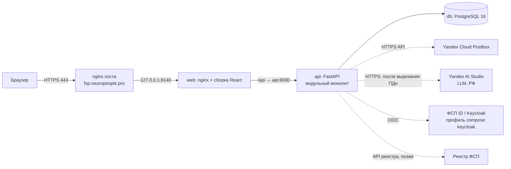
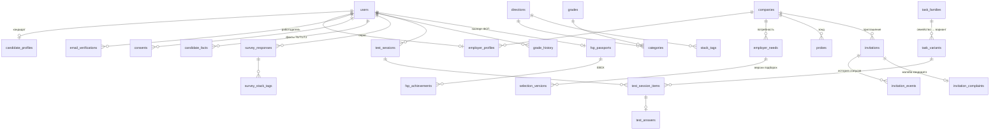

# Архитектура платформы «Встречный» (спецтрек ФСП)

Документ отвечает п. 3.4 ТЗ в части функциональной и компонентной архитектуры, модели данных,
разделения слоёв и схемы интеграции с ФСП ID. Механики тестирования, подбора и процедура валидации
описываются в отдельных документах по мере реализации (дни 2–6). Версия: 0.2 (05.10.2026, день 2).

## 1. Принципы

1. **Категория — только по подтверждённым фактам.** Опрос и резюме дают факты уровня T0, тест и зонд — T1,
   реестр ФСП — T2. Категоризация и ранжирование используют только T1/T2.
2. **Инициатива у работодателя.** Центральный сценарий — «подборка с объяснением → (зонд) → приглашение
   с вилкой → принятие → раскрытие контактов», а не отклик кандидата.
3. **Проверяемость важнее «умности».** Задания строятся из семейств проверенных шаблонов с генератором по seed;
   результаты воспроизводимы; валидация встроена в прототип (`make validate`, страница валидации).
4. **Приватность по умолчанию (152-ФЗ).** Контакты закрыты до принятия приглашения; минимум зарплаты кандидата
   скрыт; ПДн вырезаются локально до отправки текста в LLM.
5. **Простота эксплуатации.** Модульный монолит, три контейнера, бюджет памяти ≤ 1,5 ГБ.

## 2. Функциональная архитектура

### 2.1. Роли

| Роль | Что делает |
|---|---|
| Кандидат | Регистрация и подтверждение почты, опрос, выбор грейда, тест, категория и рейтинг, приглашения и зонды, паспорт ФСП, приватность |
| Работодатель | Профиль компании, потребность текстом, подборка с объяснением, поиск по базе, зонд, приглашение-оффер, статусы |
| ФСП (внешняя система) | ФСП ID (Keycloak, OIDC) и реестр достижений — источник фактов T2 |
| Жюри | Демо-режим «песочница» (снятие ограничения 90 дней), страница валидации |

### 2.2. Функциональные блоки → модули backend

| Блок | Модуль | Ключевые функции | Статус (день 2) |
|---|---|---|---|
| Учётные записи | `auth` | регистрация по почте, код подтверждения, вход (JWT), согласия 152-ФЗ | готово |
| Справочник | `catalog` | 5 направлений × 3 грейда = 15 категорий, рыночные диапазоны, стек-теги, дисциплины ЕВСК | готово |
| Профили | `profiles` | опрос, видимость полей, согласия, обезличенная карточка (`C-XXXXXX`), факты T0/T1/T2 | готово |
| Тестирование | `assessment` | адаптивный тест на банке заданий (`BankEngine`), дотестирование у порога, детектор предзнания, оценка открытых ответов по рубрике (LLM / «на проверке»), грейд, история, правило 90 дней, демо-режим жюри | готово |
| Подбор | `matching` | потребность → требования (LLM + словарь), подборка с объяснением, версии подборок, поиск | готово |
| Контакт | `invitations` | зонд (вилка), приглашение-оффер, статусы и история, раскрытие контактов, лимит 30 дней | готово |
| Взаимный подбор | `mutual` | «подойдёт ли предложение кандидату» (формат, город, вилка против скрытого минимума — только «в ожиданиях / ниже», интерес к стеку и задачам, готовность), отзывы по подборке → новая версия, «ещё похожих», ссылка руководителю на 7 дней без ПДн, «почему меня выбрали» — [MUTUAL.md](MUTUAL.md) | готово |
| ФСП | `fsp` | паспорт достижений по ЕВСК, связь с ФСП ID (заглушка), бонус в рейтинге, нейтральное «нет истории» | заглушка + демо-паспорта |
| Валидация | `validation` | precision@k, стабильность грейда, дискриминативность, устойчивость к утечке | заготовка `make validate` |
| Документы | `resume`, `pdf` | разбор PDF-резюме (pypdf), вырезание ПДн (Natasha + регулярные выражения), PDF-профиль (ReportLab) | готово |
| LLM | `llm` | OpenAI-совместимый клиент (Yandex AI Studio), таймауты, запасной путь без LLM | готово |
| Демо | `demo` | 150 кандидатов, 10 работодателей, 15 потребностей (`is_demo`) | готово |
| Уведомления | `notifications` | адаптер почты: DevMailer (лог) / Postbox (HTTPS API) | готово |

### 2.3. Сквозной сценарий (целевой)

```mermaid
sequenceDiagram
  actor C as Кандидат
  actor E as Работодатель
  participant P as Платформа
  C->>P: Регистрация, код из письма
  C->>P: Опрос (направление, стек) и выбор грейда
  P->>C: Тест: варианты из семейств заданий
  P->>P: Оценка → категория «направление · грейд», факты T1, рейтинг
  E->>P: Профиль компании, потребность текстом
  P->>E: Подборка: категории и обезличенные кандидаты + «почему» (T1/T2)
  opt Зонд
    E->>P: Короткая задача с вилкой зарплаты
    P->>C: Зонд (15 минут)
    C->>P: Решение или подход
  end
  E->>P: Приглашение: вилка «от–до» ₽, компания, суть, способ связи
  P->>C: Входящее приглашение
  C->>P: Принять / отклонить
  P->>E: Статус; при принятии — контакты кандидата
```

## 3. Компонентная архитектура



| Компонент | Технология | Память (лимит) | Порт |
|---|---|---|---|
| web | nginx 1.27 + статика Vite | 96 МБ | 127.0.0.1:8140 → 80 |
| api | Python 3.12, FastAPI, uvicorn (2 воркера), Natasha, ReportLab | 896 МБ | 127.0.0.1:8141 → 8000 |
| db | PostgreSQL 16 (shared_buffers 128 МБ) | 512 МБ | только внутренняя сеть compose |
| keycloak (выкл.) | Keycloak 26, `start-dev` | 768 МБ | 127.0.0.1:8142 (профиль `keycloak`) |

Итого лимиты стека: 96 + 896 + 512 = 1504 МБ ≈ 1,5 ГБ (фактически api ≈ 170 МБ, Natasha загружается лениво).

Миграции Alembic применяются при старте контейнера api. OpenAPI: `/api/docs` (Swagger UI), `/api/redoc`,
`/api/openapi.json`; файлы Swagger UI 5.33.1 и ReDoc 2.5.4 раздаются с нашего сервера (`/api/static/apidocs`),
внешние CDN не используются.

## 4. Разделение слоёв (backend)

```
app/
  core/            конфигурация, БД (Base, сессии), безопасность (argon2, JWT, коды), зависимости, ошибки, перечисления
  modules/<name>/
    models.py      слой хранения (SQLAlchemy 2, только свои таблицы)
    schemas.py     контракты API (Pydantic v2)
    service.py     бизнес-логика (без HTTP)
    router.py      HTTP-слой (FastAPI): валидация, коды ошибок, OpenAPI
  models.py        единая metadata для Alembic
assessment_bank/   копия пакета банка заданий (чистый Python без БД и без сети); обновляется tools/sync_bank.py
migrations/        Alembic (0001 — ядро схемы, 0002 — справочник)
```

Правила: роутер вызывает только сервис своего модуля; модули общаются через сервисы, а не через чужие роутеры;
внешние системы (почта, LLM, ФСП, тест) — только через адаптеры (`notifications.mailer`, `llm.client`,
`assessment.engine`, будущий `fsp.client`).
Код кандидатов на сервере не исполняется: форматы заданий — «найди ошибку», «предскажи вывод», «выбери исправление»,
«открытая книга в 3 шага», концептуальный выбор, открытый ответ по рубрике.

Ошибки API: `{"detail": {"code": "<машинный код>", "message": "<текст по-русски>"}}`; коды задокументированы в OpenAPI.

## 5. Модель данных

Перечисления хранятся как VARCHAR + CHECK (переносимо PostgreSQL ↔ SQLite для тестов), JSON-поля — JSONB в PostgreSQL.
Имена ограничений задаются единым соглашением (`pk_`, `fk_`, `uq_`, `ck_`, `ix_`).



| Группа | Таблицы | Важные правила в схеме |
|---|---|---|
| Учётные записи | `users`, `email_verifications`, `consents` | почта уникальна (в нижнем регистре); пароль — argon2id; код хранится как HMAC, ≤5 попыток, 15 мин; `token_version` отзывает JWT; `fsp_subject` — sub из ФСП ID |
| Справочник | `directions`, `grades`, `categories`, `stack_tags` | 5×3 категорий, `market_salary_from ≤ market_salary_to`; стек с `direction_id = NULL` — общий блок |
| Профили | `candidate_profiles`, `companies`, `employer_profiles`, `candidate_facts` | `salary_min_hidden` не отдаётся работодателю; текущая категория ставится только по тесту; `candidate_facts.evidence_level ∈ {T0,T1,T2}` |
| Тестирование | `survey_responses`, `survey_stack_tags`, `task_families`, `task_variants`, `test_sessions`, `test_session_items`, `test_answers`, `grade_history` | вариант = `family_id:seed` (уникален); ключ ответа только на сервере; `form_seed` сессии для воспроизводимости; канареечные семейства и карантин по экспозиции; история грейда с `locked_until` (90 дней, кроме песочницы) |
| Подбор | `employer_needs`, `selection_versions` | уточнение фильтров создаёт новую версию (`need_id, version` уникальны) — прежняя подборка не теряется |
| Взаимный подбор | `candidate_preferences`, `selection_feedback`, `selection_shares`, `share_reactions`, `offer_fit_checks` | интересы — T0, в скор не входят; отзыв один на (потребность, кандидат); у ссылки хранится только SHA-256 токена, срок 7 дней, `revoked_at`; журнал сравнений вилки ограничивает подбор минимума |
| Контакт | `probes`, `invitations`, `invitation_events` | вилка обязательна: `salary_from > 0 AND salary_from ≤ salary_to`; индекс пары «компания — кандидат — дата» для правила 30 дней; статусы sent → viewed → accepted/declined/withdrawn/expired и журнал переходов; `contacts_revealed_at` |
| ФСП | `fsp_passports`, `fsp_achievements` | дисциплина по ЕВСК, уровень мероприятия, место, `verified` (T2); нет паспорта — нейтральное состояние |
| Второй фактор | `user_two_factor`, `user_two_factor_recovery_codes` | секрет — Fernet; `last_used_step` не даёт повторить код; `fail_count`/`locked_until` — блокировка; резервные коды — только хэш, `used_at` |
| Мои данные | `candidate_interest_events`, `account_deletion_log`, `candidate_profiles.deleted_at` | событие интереса — «карточку открыла компания / вы в подборке» со случайными ключами компании и потребности (названий нет), хранится 90 дней; журнал уничтожения — дата, роль, числа по категориям, без идентификаторов; `deleted_at` — метка профиля-«надгробия» (миграция `md01`, `docs/MY_DATA.md`) |

## 6. Безопасность и 152-ФЗ

- Пароли — argon2id (`argon2-cffi`), прозрачный rehash при смене параметров. JWT HS256, срок 12 ч, `iss`, `ver`.
- Коды подтверждения: 6 цифр, `secrets`, хранится только HMAC-SHA256; лимит попыток и частоты повторной отправки;
  повторная отправка не раскрывает, зарегистрирован ли адрес; выравнивание времени ответа при входе.
- Согласие на обработку ПДн обязательно при регистрации и фиксируется с версией документа (`consents`).
- Разграничение по ролям (`require_role`), кандидат видит только свои записи; контакты кандидата — после принятия.
- ПДн (ФИО, почта, телефон, ники, ссылки на профили, дата рождения, СНИЛС) вырезаются на нашем сервере (Natasha, MIT,
  + регулярные выражения) до отправки текста в LLM; найденные значения в БД не сохраняются, исходный PDF не хранится.
- Работодатель видит обезличенную карточку (`C-XXXXXX`); контакты — только после принятия приглашения; скрытый минимум
  зарплаты кандидата не показывается никогда (работодателю — рыночный диапазон категории).
- Согласие на публикацию профиля отзывается в один клик — профиль сразу исчезает из подборок и поиска.
- «Мои данные» (`docs/MY_DATA.md`): кандидат видит перечень хранимого со сроками, скачивает всё одним JSON (без чужих данных,
  заданий и секретов), закрывает доступ к контактам и удаляет учётную запись (слово «УДАЛИТЬ» + пароль/почта + код 2FA). Личные
  данные стираются сразу по схеме БД (каскад), записи работодателя (приглашения, зонды, отклики) обезличиваются, профиль
  остаётся «надгробием» без данных, паспорт грейда отзывается, почта освобождается. Резервные копии БД — 14 последних.
- Порты контейнеров — только 127.0.0.1; TLS на nginx хоста; секреты в `.env` и `secrets/` (вне git).

### 6.1. Второй фактор входа (TOTP, RFC 6238)

- Обязателен для `admin` и `fsp_analyst` с реальной почтой (`TWOFA_REQUIRED_ROLES`), эксперту панели — по желанию, кандидату и
  работодателю не предлагается. Демо-персоны жюри входят в один клик без кода; для проверки жюри может подключить второй
  фактор в `/fsp/security` (в разделе есть пометка про демо), «Сбросить демо» снимает подключение.
- Вход двухшаговый: `/api/auth/login` после верного пароля возвращает не JWT, а короткоживущий промежуточный токен
  (`typ=2fa`, 5 мин) либо токен обязательного подключения (`typ=2fa_setup`, 15 мин); к защищённым маршрутам такие токены
  не допускаются (401 `second_factor_required`), `/api/auth/token` для учётки с 2FA — 403. Код проверяется в
  `POST /api/auth/2fa/verify`; после него выдаётся обычный JWT с `amr`.
- Приложения-аутентификаторы (SHA-1, 6 цифр, шаг 30 с, окно ±1 шаг), QR и ключ для ручного ввода, 10 резервных кодов
  `XXXX-XXXX` (хранится только хэш, каждый одноразовый). Секрет в базе зашифрован Fernet (`TWOFA_SECRET_KEY`, иначе
  выводится из `JWT_SECRET`). Повтор уже принятого шага отклоняется (`code_reused`); 5 неверных кодов подряд — блокировка
  учётки на 15 минут (429) и лимит 30 попыток за 15 минут с одного адреса.
- Отключение и перевыпуск — только с текущим кодом; для обязательных ролей отключение запрещено (403). Потерян телефон:
  администратор сбрасывает в разделе «Безопасность входа» (`POST /api/admin/2fa/reset`, все сеансы пользователя отзываются)
  или `python -m app.modules.auth reset-2fa --email …`. Служебные учётки создаёт `python -m app.modules.auth add-staff`.
- Таблицы `user_two_factor`, `user_two_factor_recovery_codes` (миграция `tf01`). Код — `app/core/totp.py`,
  `app/modules/auth/twofa.py`, `twofa_router.py`; экраны — `frontend/src/pages/Security.tsx`; тесты — `tests/test_twofa.py`
  и `e2e/tests/12-twofa.spec.ts`.

## 7. Интеграция с ФСП ID (Keycloak) и реестром ФСП

ТЗ: «ФСП ID будет работать на базе Keycloak»; API и структура данных ФСП не предоставляются. Решение — стандартный
OIDC, без привязки к особенностям конкретной инсталляции.

### 7.1. Связка аккаунта (MVP+)

```mermaid
sequenceDiagram
  actor C as Кандидат
  participant W as web
  participant A as api
  participant K as ФСП ID (Keycloak, realm fsp)
  participant R as Реестр ФСП
  C->>W: «Связать с ФСП ID»
  W->>A: GET /api/fsp/oidc/start
  A->>W: redirect: /realms/fsp/protocol/openid-connect/auth (code + PKCE, state, nonce)
  W->>K: вход участника ФСП
  K->>A: GET /api/fsp/oidc/callback?code=…&state=…
  A->>K: POST /token (code_verifier) → id_token, access_token
  A->>A: проверка подписи по JWKS, iss, aud, nonce
  A->>A: users.fsp_subject = sub; fsp_passports(link_source=keycloak)
  A->>R: запрос достижений по sub (сервисный клиент, client_credentials)
  R-->>A: дисциплина ЕВСК, мероприятие, уровень, дата, место, разряд
  A->>A: fsp_achievements(verified=true) → candidate_facts(T2)
```

- Конфигурация: `FSP_OIDC_ISSUER` (`https://<host>/realms/fsp`), `FSP_OIDC_CLIENT_ID`; конфиденциальный клиент
  с Authorization Code + PKCE; discovery — `/.well-known/openid-configuration`.
- Минимум данных: `sub` (обязательно), `email` (для сверки). ФИО из ФСП не требуется — приватность.
- Без ФСП ID или без достижений — паспорт отсутствует, это нейтральное состояние (без штрафа в рейтинге).
- На хакатоне реестр недоступен: паспорт заполняется демо-данными (`link_source=demo`, факты T1-демо помечаются явно).

### 7.2. Вход через ФСП ID — реализовано (день 3Б)

Демо-стенд «ФСП ID» — Keycloak 26, realm `fsp`, профиль compose `fsp-id`, путь `/auth` того же домена. Вход и
связка реализованы в `backend/app/integrations/fsp_id/` (эндпоинты `/api/fsp-id/*`, BFF: токены Keycloak в браузер
не попадают), claims `fsp_*` → паспорт ФСП с фактами T2. Подробно — [FSP_INTEGRATION.md](FSP_INTEGRATION.md).

## 7А. Интеграции (день 3Б)

Пакет `backend/app/integrations/*` подключается одной функцией `include_routers(app)`; фронтенд —
`frontend/src/integrations/*`. Модули ядра не зависят от интеграций (кроме двух фоновых хуков в `invitations`).

| Модуль | Что делает | Документ |
|---|---|---|
| `egrul` | проверка работодателя по ИНН в ЕГРЮЛ (egrul.nalog.ru), кэш 7 дней, индекс доверия 0–100 с причинами | [ANTIFRAUD.md](ANTIFRAUD.md) |
| `fsp_id` | вход и связка через ФСП ID (OIDC + PKCE), claims → паспорт T2 | [FSP_INTEGRATION.md](FSP_INTEGRATION.md) |
| `ats` | Хантфлоу API v2, вебхук HMAC, экспорт JSON, тестовая ATS-заглушка | [ATS.md](ATS.md) |
| `vacancies` | вакансии (вилка обязательна) и отклики, статусы у обеих сторон, контакты после отклика | — |
| `push` | Web Push (VAPID): кандидату — приглашение и статус отклика, работодателю — принятие и новый отклик | — |
| `sus` | опрос SUS (10 вопросов, балл 0–100), сводка для `/validation`: `GET /api/sus/summary` | — |

PWA: `frontend/public/manifest.webmanifest`, `sw.js` (оболочка офлайн, API — только сеть, push), иконки
`public/icons/`, страница `/install`. Нагрузочный тест — [LOAD_TEST.md](LOAD_TEST.md).

## 8. Банк заданий (формат)

Пакет `assessment_bank` (чистый Python, без БД). Семейство = YAML-описание + генератор `generate(seed) -> Variant`.
Поля семейства: `family_id`, `direction` (common|backend|frontend|data_ml|qa|security), `skills[]`, `target_grades[]`,
`format` (find_bug | predict_output | choose_fix | open_book_3step | mcq_concept | open_answer), `invariants`,
`time_limit_s`, `canary`, `prior_difficulty`. Variant: `variant_id` (family_id + seed), `stem`, `code`, `options`,
`answer_key`, `rubric`, `meta`. В БД — таблицы `task_families` и `task_variants`; валидатор проверяет детерминизм,
инварианты, уникальность и разнообразие вариантов.

### 8.1. Точка интеграции сервиса тестирования

Бэкенд работает с тестом только через протокол `AssessmentEngine` (`backend/app/modules/assessment/engine.py`):

| Метод | Вход | Выход |
|---|---|---|
| `start` | направление, заявленный грейд, стек-теги, seed | состояние сессии (JSON, хранится в `test_sessions.result.state`) |
| `next_item` | состояние | `ItemPublic` (без ключа и рубрики) или `None` |
| `answer` | состояние, `item_id`, ответ, время | `AnswerFeedback` (принят, отвечено, всего, завершён) |
| `finish` | состояние | `EngineResult`: θ, SE, точечный грейд, подтверждён ли заявленный, P(грейд), навыки по стеку |

Рабочий движок — `BankEngine` (`app/modules/assessment/bank_engine.py`, `ASSESSMENT_ENGINE=bank`); заглушка
`StubEngine` (6 вопросов, Раш + EAP) остаётся запасным путём: если пакет банка не загрузился, API стартует на ней
и пишет ошибку в лог. Правила грейда (90 дней, «не понижать при неудаче», демо-режим жюри) — в
`assessment/rules.py`, вне движка.

### 8.2. Сессия теста на банке

- **Состав.** Общий блок (≈ 40 %) + блок направления; выбор следующего семейства — максимум информации
  (`psychometrics.CATSession`, IRT по частям задания): первые 4 задания — в текущей θ̂, дальше — в ближайшем
  неопределённом пороге грейда (порог внутри θ̂ ± 1,28·SE). Канарейки — на позициях 2, 6, 10, в θ не входят.
- **Остановка (классификация по грейду, с 06.10).** Основная часть — 8–16 заданий, до 60 минут: стоп, когда ни один
  порог не лежит в θ̂ ± 1,28·SE, или SE ≤ 0,35, или лимит / исчерпание субпула. Если ближайший порог ещё внутри
  интервала — дотестирование до точности у этого порога: до 6 коротких заданий (лимит ≤ 5 мин, всего ≤ 20 мин), сначала
  из своего субпула, затем из остального банка направления; семейства прошлой попытки и субпулы на карантине не
  берутся; стоп, как только порог вышел из интервала. Настройки `ASSESSMENT_STOP_RULE`, `ASSESSMENT_CLASSIFY_Z`,
  `ASSESSMENT_SELECT_AT`, `ASSESSMENT_EXTENSION_ITEMS`, `ASSESSMENT_EXTENSION_MINUTES`, `ASSESSMENT_EXTENSION_OWN_FIRST`;
  сессии, начатые до обновления, доигрываются по прежним правилам. Обоснование и метрики «до/после» —
  `reports_0610/stability.md` и раздел «Повтор» на /validation.
- **Состав и частота показа (день 3А).** Не больше 2 заданий open_book_3step и 1 open_answer в сессии. Контроль частоты
  Sympson — Hetter: параметры K_f (`app/modules/assessment/exposure_k.json`, цель r_max = 0,3) подбираются симуляцией
  `tools/calibrate_exposure.py`. Ротация субпулов: банк поделён на 2 субпула, повторная попытка идёт по другому;
  утёкший субпул выводится настройкой `ASSESSMENT_SUBPOOL_QUARANTINE`.
- **Достоверность результата.** Интерфейс теста передаёт с каждым ответом сигналы: уход со вкладки / потеря фокуса,
  вставка текста; сервер добавляет аномально быстрые ответы (порог — от ожидаемого времени семейства на уровне θ и
  длины текста, в экспрессе и у жюри без других сигналов — мягкая пометка; docs/ANTIFRAUD.md, 6.2) и детектор
  предзнания по канарейкам. Баллы: 0 — высокая,
  1–2 — средняя, ≥ 3 — низкая; уровень и причины видны работодателю в карточке и в объяснении подборки (на скор не влияют).
- **Экспертная проверка.** Развёрнутые ответы «на проверке» (LLM недоступен) и выборочно оценённые LLM видит эксперт
  (`/expert`, роль admin), ставит баллы по критериям рубрики; θ пересчитывается, согласие эксперта и LLM — на `/validation`.
- **Решение.** `psychometrics.decide`: подтверждён, если P(уровень ≥ заявленного) ≥ 0,8; «можно выше» при
  P(следующий) ≥ 0,9; принудительного понижения нет. Досрочно завершить тест нельзя (`409 test_not_complete`).
- **Одна шкала θ → категория (Ф3, 08.10).** `grades.category_level` — для всех режимов (полный, экспресс,
  дотестирование, мини-тест QR): категория — наивысший грейд с P(θ ≥ порога) ≥ 0,8, но не выше потолка
  `grades.ceiling`: меньше 5 оценённых заданий или SE > 0,75 — не выше Middle. `decide_grade(..., n_items)` применяет
  тот же потолок к заявленному грейду (короткий тест Senior не подтверждает, уровень ниже остаётся доступным).
  Мини-тест (3 задания) берёт категорию напрямую и всегда помечает её «предварительно»: 3 из 3 при θ = +1,01 ± 0,77 —
  «Backend · Middle (предварительно)», как экспресс 7 из 7 при θ = +1,40 ± 0,72 — Middle. Три задания мини-теста —
  три разных сюжета (`jury_live.mini.same_plot`: тот же тип дефекта или та же тема с общим предметным навыком).
- **Единые числа.** θ и SE итога округляются один раз — `app.core.fmt.theta_round` (два знака, «половина — от нуля»
  по десятичной записи, как `Intl.NumberFormat` в ui.tsx `num`/`signed`) в `BankEngine.finish`, `StubEngine.finish`
  и `mini.result`; серверные тексты — `fmt.ru_num`/`theta_se`, интерфейс — `num`/`signed`: экран итога, плашка,
  «Почему в подборке», приглашение и телефон гостя показывают одно «+1,40 ± 0,72».
- **Скрытие ключей.** Кандидату уходят только stem, код и варианты текущего шага. `item_id` — случайный токен;
  `family_id`, `variant_id`, seed, ключ и рубрика остаются в состоянии сессии и в БД. Seed рабочих вариантов —
  из криптостойкого ГСЧ (~2·10⁹ значений): генераторы открыты (MIT), но перебрать варианты заранее нельзя.
- **Форматы.** `find_bug` — выбор строки; `predict_output` — текст, сверка после `metrics.normalize_output`;
  `choose_fix`, `mcq_concept` — вариант A–F; `open_book_3step` — три шага по очереди (воспроизвести, исправить —
  варианты; объяснить — текст); `open_answer` — текст. Код кандидатов не исполняется.
- **Время.** Сервер фиксирует момент показа и каждого ответа (по шагам), клиентское время хранится справочно.
  log T идёт в модель времени детектора предзнания (`CanaryDetector`: скорость на канарейках + «быстро и верно»).
  При срабатывании θ пересчитывается без подозрительных ответов; факт виден в данных сессии, не кандидату.
- **Хранение.** Состояние — JSON `test_sessions.result.state` (CATSession пересобирается на каждом запросе,
  строка сессии блокируется `SELECT … FOR UPDATE`). Нормализованная копия — `task_families`, `task_variants`,
  `test_session_items`, `test_answers` (ответ, баллы по частям, время) — для калибровки банка и аудита.
- **Экспозиция.** Ограничение Sympson–Hetter выключено: банк пока мал (≈ 130 семейств на 05.10, 164 на 08.10), уникальность обеспечивают
  случайные seed вариантов. Ротация субпулов — `ASSESSMENT_SUBPOOLS` (по умолчанию 1, т. е. выключена).
- **Пополнение банка.** Пакет `../bank` не изменяется; `tools/sync_bank.py` (вызывается из скрипта выкладки) копирует
  его в `backend/assessment_bank`, прогоняет валидатор банка и проверку генерации/`public_view`, исключает
  семейства с ошибками и пишет манифест `BANK_SYNC.json` (коммит источника, хэш содержимого, состав, исключения).
  Новые семейства попадают в тест при следующей выкладке; версия банка — в имени движка `bank-<хэш>`.

## 9. API (на 05.10.2026, день 2)

| Метод | Путь | Назначение | Ошибки |
|---|---|---|---|
| GET | `/api/health` | состояние API и БД (`status`, `db`; версия и режимы — в `/api/meta`) | — |
| POST | `/api/auth/register` | регистрация (candidate/employer), согласие ПДн; в DEV_MODE — код в ответе | 409, 422 |
| POST | `/api/auth/verify-email` | подтверждение почты кодом → JWT | 400, 429 |
| POST | `/api/auth/resend-code` | повторная отправка кода | 429 |
| POST | `/api/auth/login` | вход (JSON) → JWT | 401, 403 |
| POST | `/api/auth/token` | вход формой OAuth2 (Swagger Authorize) | 401, 403 |
| GET | `/api/auth/2fa` | состояние второго фактора текущего пользователя | 401 |
| POST | `/api/auth/2fa/setup`, `/confirm` | подключение приложения-аутентификатора (QR, ключ, первый код → резервные коды) | 400, 401 |
| POST | `/api/auth/2fa/verify` | второй шаг входа: код или резервный код + промежуточный токен → JWT | 400, 401, 429 |
| POST | `/api/auth/2fa/check`, `/disable`, `/recovery-codes` | проверка кода, отключение, новые резервные коды (все — с текущим кодом) | 400, 401, 403, 429 |
| GET, POST | `/api/admin/2fa/users`, `/api/admin/2fa/reset` | список подключений и сброс администратором | 401, 403, 409 |
| GET | `/api/me` | текущий пользователь, профиль, статус ФСП | 401 |
| PATCH | `/api/me/candidate-profile` | обновление профиля кандидата | 401, 403 |
| PATCH | `/api/me/company` | обновление компании работодателя | 401, 403, 404 |
| GET | `/api/catalog` | направления, грейды, категории, стек, дисциплины ЕВСК | — |
| GET | `/api/catalog/stack-tags?direction=` | стек для опроса (с общим блоком) | — |
| GET | `/api/me/data`, `/api/me/data/export`, `/api/me/data/delete/preview`, `/api/me/interest` | «Мои данные»: что хранится, выгрузка одним JSON, что будет удалено; обезличенная отметка интереса за 7 дней | 401, 403 |
| POST | `/api/me/data/delete`, `/api/me/data/contacts/revoke` | удаление учётной записи (подтверждение «УДАЛИТЬ» + пароль/почта + код 2FA), закрытие доступа к контактам у всех работодателей | 400, 401, 403, 422, 429 |
| GET/PUT | `/api/me/onboarding` | опрос: направление, стек, стаж, роли, формат, город, скрытый минимум, видимость, согласие | 401, 403, 422 |
| PUT | `/api/me/privacy`, `/api/me/jury-mode` | видимость полей карточки; демо-режим жюри (снятие правила 90 дней) — только демо-учёткам (`users.is_demo`), новых тестов в нём не больше `JURY_MAX_TEST_STARTS_PER_DAY` (5) за 24 ч на почту | 401, 403 |
| GET/POST/DELETE | `/api/me/consents[/{kind}]`, `/api/legal/consents/{kind}` | согласия 152-ФЗ и их тексты | 401, 404 |
| POST | `/api/assessment/sessions` → GET `/{id}` → POST `/{id}/answers` → `/{id}/finish` | адаптивный тест на заявленный грейд: задание без ключа, ответ (вариант / строка / текст, шаг), θ, SE, категория; `integrity_ack` — кандидат прочитал экран «что отслеживается» | 401, 403, 409, 422, 423, 429 |
| GET | `/api/assessment/status` | категория и грейд, история, правило 90 дней, доступность демо-режима и остаток запусков | 401, 403 |
| GET | `/api/assessment/feedback[?session_id=]` | обратная связь после теста (`assessment/feedback.py`): карта навыков по темам банка без заданий и ключей, разрыв с требованиями активных потребностей и вакансий категории, маршрут роста, дисциплины ФСП; блок — и в PDF-профиле кандидата | 401, 403, 404, 409 |
| POST/GET | `/api/me/resume`, `/api/me/resume/{id}/apply` | PDF-резюме: текст без ПДн, поля T0 | 401, 413, 415, 422 |
| GET | `/api/me/card`, `/api/me/profile.pdf`, `/api/me/fsp`, POST `/api/me/fsp/link` | карточка, PDF-профиль, паспорт ФСП | 401, 403 |
| POST | `/api/employer/needs/parse`, `/api/employer/needs` | потребность текстом → требования → подборка v1 | 401, 403, 422 |
| GET/POST | `/api/employer/needs/{id}/selections[/{v}]` | версии подборок: категории, карточки, объяснения | 401, 403, 404, 422 |
| GET | `/api/employer/needs/{id}/selections/{v}/what-if` | «Что если» (`matching/whatif.py`): сколько полностью подходят и какое требование отсекает больше всего подтверждённых; ослабление — новой версией ([docs/jury_match](jury_match/README.md)) | 401, 403, 404 |
| GET | `/api/employer/needs/{id}/compare?refs=&refs=&version=` | сравнение 2–3 кандидатов по требованиям потребности, «почему A выше B» | 401, 403, 404, 422 |
| GET | `/api/employer/candidates`, `/api/employer/candidates/{ref}[/profile.pdf]`, `/api/employer/categories` | поиск по базе, карточка, PDF | 401, 403, 404 |
| POST/GET | `/api/employer/probes`, `/{id}/review`; `/api/candidate/probes`, `/{id}/answer`, `/{id}/decline` | зонды | 401, 403, 404, 409, 422 |
| POST/GET | `/api/employer/invitations`, `/{id}/withdraw`; `/api/candidate/invitations`, `/{id}/accept`, `/{id}/decline` | приглашения, статусы, история | 401, 403, 404, 409, 422 |
| POST | `/api/candidate/invitations/{id}/complaint` | жалоба: нереальная вилка, не та роль, спам, другое → индекс доверия | 401, 403, 404, 409, 422 |
| GET | `/api/meta` | название продукта, оператор ПДн, LLM, движок теста; `rules` — сроки правил из настроек (смена грейда, повтор после неподтверждённой попытки, повторное приглашение), тексты главной и форм берут их отсюда | — |

Полный список с кодами ошибок — `/api/docs`.

## 10. Библиотеки и версии

| Компонент | Версия | Лицензия |
|---|---|---|
| Python | 3.12 | PSF |
| FastAPI | 0.142.2 | MIT |
| uvicorn | 0.54.0 | BSD-3 |
| SQLAlchemy | 2.1.3 | MIT |
| Alembic | 1.20.0 | MIT |
| Pydantic / pydantic-settings | 2.13.5 / 2.15.0 | MIT |
| argon2-cffi | 25.1.0 | MIT |
| PyJWT | 2.15.1 | MIT |
| psycopg | 3.3.6 | LGPL-3.0 |
| boto3 (Postbox SESv2) | 1.43.108 | Apache-2.0 |
| PyYAML | 6.0.3 | MIT |
| pytest / httpx | 9.1.1 / 0.28.1 | MIT / BSD-3 |
| pypdf / ReportLab | 6.19.0 / 5.0.1 | BSD-3 / BSD-3 |
| Natasha (NER) | 1.6.0 | MIT |
| NumPy / SciPy (движок теста) | 2.1.3 / 1.14.1 | BSD-3 / BSD-3 |
| assessment_bank (банк заданий, копия) | см. `backend/assessment_bank/BANK_SYNC.json` | MIT |
| Swagger UI / ReDoc (локально) | 5.33.1 / 2.5.4 | Apache-2.0 / MIT |
| PostgreSQL | 16 (alpine) | PostgreSQL |
| React / React Router | 18.3 / 6.30 | MIT |
| Vite / TypeScript | 5.4 / 5.9 | MIT / Apache-2.0 |
| Tailwind CSS | 3.4 | MIT |
| Montserrat (@fontsource) | 5.x | OFL-1.1 |
| nginx | 1.27 (alpine) | BSD-2 |
| Keycloak (опционально) | 26.0 | Apache-2.0 |

## 11. Развёртывание

Сервер: `/opt/git/spectrek_fsp.git` (голый репозиторий) → рабочая копия `/opt/spectrek_fsp/app` →
`docker compose up -d --build`. Секреты: `/opt/spectrek_fsp/app/.env` (права 600), ключи почты —
`/opt/spectrek_fsp/secrets/postbox.env` (подключается как `env_file`). nginx хоста — отдельный файл сайта:

```nginx
server {
    listen 443 ssl;
    server_name fsp.neuropeople.pro;
    ssl_certificate     /etc/letsencrypt/live/fsp.neuropeople.pro/fullchain.pem;
    ssl_certificate_key /etc/letsencrypt/live/fsp.neuropeople.pro/privkey.pem;
    location / { proxy_pass http://127.0.0.1:8140; proxy_set_header Host $host;
                 proxy_set_header X-Forwarded-Proto $scheme; }
}
```

Сертификат: `certbot certonly --webroot -w /opt/spectrek_fsp/acme -d fsp.neuropeople.pro --deploy-hook "systemctl reload nginx"`.

Полный рабочий файл сайта (без секретов) — `infra/nginx/fsp.neuropeople.pro.conf.example`: редирект на HTTPS,
`/robots.txt` с `Disallow: /`, `/api/` и файлы PWA без базовой авторизации, `/auth/` (Keycloak «ФСП ID») со своим входом,
остальное — под базовой авторизацией (`auth_basic_user_file /etc/nginx/htpasswd_spectrek_fsp`). Логин и пароль стенда — в материалах сдачи, в репозитории их нет.

Живая демонстрация (QR): место гостя считается по всей выдаче потребности (в мире из 500 кандидатов оно бывает ниже 60-го,
`ranking.build_selection(include_refs=…)`), а приглашение уходит каждому, кому мини-тест дал экспресс-категорию, независимо от места.
Она открывается с телефона эксперта без пароля: фрагмент `infra/nginx/fsp.neuropeople.pro.jury-live.conf`
открывает `/j/<код>` (точное выражение — `/j`, `/j/`, `/j/a/b` остаются под паролем), `/assets/` (JS, CSS, шрифты) и
`/recover.js`; `sw.js`, манифест, иконки и `/api/` уже открыты основным конфигом. Установка —
`sudo bash infra/nginx/apply-public-snippets.sh`: копирует фрагменты (QR и, если есть, паспорта `/verify/<id>`) в
`/etc/nginx/snippets/`, вставляет `include` перед защищённым `location / {`, `nginx -t` (при ошибке возвращает файл сайта и
фрагменты), reload и проверка адресов; `--check` — только проверка. `/assets/` открывает только фрагмент QR — повтор
`location ^~ /assets/` в другом фрагменте даёт `duplicate location`. Пароль стенда — ворота для загрузки страниц, а не
защита данных: данные отдаёт только `/api` по JWT.

### 11.1. Мониторинг стенда

`infra/monitor/monitor.py` — одна проверка за запуск, только стандартная библиотека Python 3.10+ хоста (без boto3 и
pip). Запускает systemd-таймер `spectrek-monitor.timer` раз в 5 минут; настройки — `/opt/spectrek_fsp/infra/monitor.env`
(образец `infra/monitor/monitor.env.example`), ключи Postbox и Yandex AI Studio — из секретов приложения
(`MONITOR_ENV_FILES`), в файл мониторинга не копируются. Состояние — `/var/lib/spectrek-monitor/state.json`.

| Проверка | Что считается сбоем | Что делать |
|---|---|---|
| Сайт и API (`site`) | `GET /api/health` не 200 или `status != ok` | `docker compose ps`, `docker compose logs --tail 200 api`; БД — `docker compose logs db` |
| Фронтенд (`web`) | `GET /` не 200 и не 401 (401 — пароль стенда, это норма) | `docker compose logs web`; `sudo nginx -t`, `systemctl status nginx` |
| QR без пароля (`jury`, при `MONITOR_CHECK_JURY_LIVE=1`) | `/j/monitor` требует пароль или не отвечает | фрагмент `infra/nginx/fsp.neuropeople.pro.jury-live.conf` подключён? (`grep jury_live /etc/nginx/sites-available/fsp.neuropeople.pro`) |
| Yandex AI Studio (`llm`, раз в час) | ответ не 200: 401 — ключ, 403 — права каталога (`ai.languageModels.user`, так было 06.10), 429 — квота | ключ и каталог в `/opt/spectrek_fsp/secrets/llm.env`; пока не починено, продукт работает по запасному пути без LLM |
| Диск (`disk`) | занято больше `MONITOR_DISK_MAX_PCT` (90 %) | `docker system df`, `docker image prune -f`, старые копии в `/opt/spectrek_fsp/backups` |
| Контейнеры (`docker`) | api, db или web не запущен, OOM, память api > 90 % лимита (1536 МБ с 08.10; было 768 МБ) | `docker inspect -f '{{.State.OOMKilled}} {{.RestartCount}}' spectrek_fsp-api-1`, `docker stats --no-stream` |
| Резервная копия (`backup`) | нет `*.sql.gz` в `/opt/spectrek_fsp/backups/db` моложе 30 ч | cron резервного копирования, свободное место |

Письмо (Postbox, API SESv2 `SendEmail`, подпись SigV4 своей реализацией) уходит после `MONITOR_FAILS` (2) неудач
подряд — разовый тайм-аут не будит; напоминание — раз в `MONITOR_REMIND_H` (6) часов, пока сбой не прошёл; при
восстановлении — письмо «восстановлено». Если Postbox письмо не принял, следующий запуск пробует снова. Пока
`MONITOR_TO` пуст (почту даст владелец), письма выключены: текст письма один раз пишется в журнал, без повторов.

```bash
python3 infra/monitor/monitor.py --print       # все проверки сейчас, без писем и без записи состояния (MONITOR_TO не нужен)
python3 infra/monitor/monitor.py --test-mail   # пробное письмо на MONITOR_TO (проверка ключей Postbox и адреса)
journalctl -u spectrek-monitor.service -n 50   # итоги запусков таймера
systemctl list-timers spectrek-monitor.timer   # когда следующий запуск
```

Установка на сервере (координатор):

```bash
sudo mkdir -p /opt/spectrek_fsp/infra
sudo cp infra/monitor/monitor.env.example /opt/spectrek_fsp/infra/monitor.env && sudo chmod 600 /opt/spectrek_fsp/infra/monitor.env
sudo cp infra/monitor/spectrek-monitor.service infra/monitor/spectrek-monitor.timer /etc/systemd/system/
sudo systemctl daemon-reload && sudo systemctl enable --now spectrek-monitor.timer
```

## 12. LLM-слой

Подробно — [docs/LLM.md](LLM.md): какая модель где и почему, цепочка, вторая оценка, ПДн, таблица «качество / время».

- Цепочка провайдеров `LLM_CHAIN` (на сервере `openrouter,yandex`): Claude Sonnet 5.5 через OpenRouter (с сервера —
  через ретранслятор `LLM_RELAY_URL`) → Yandex AI Studio → правила. Переход при ошибке сети, тайм-ауте,
  HTTP ≠ 200, пустом или невалидном JSON; автомат-выключатель; модель и тайм-аут на функцию (`parse_need`, `resume`,
  `grade`, `grade_second`). Вторая оценка спорных открытых ответов — Claude Fable 5.1. В OpenRouter уходит только
  обезличенный текст (ПДн вырезаются до вызова), `data_collection = deny`. Без `LLM_CHAIN` — как раньше, один
  провайдер `LLM_*`.
- Провайдер `LLM_*`: **Yandex AI Studio** (`https://llm.api.cloud.yandex.net/v1`, OpenAI-совместимый API), модель
  `yandexgpt/latest`; модели размещены в Yandex Cloud в РФ.
- Клиент `app/modules/llm/client.py` провайдер-агностичный: `LLM_PROVIDER=yandex_ai_studio` добавляет заголовки
  `Authorization: Api-Key …` и `OpenAI-Project: <каталог>`; для любого другого OpenAI-совместимого — `Bearer`.
  Ответ моделей с рассуждениями читается и из `reasoning_content`. Таймаут 25 с (подключение 5 с), ключ в логи не пишется.
- Секреты: `/opt/spectrek_fsp/secrets/llm.env` подключается как `env_file` сервиса api (`LLM_ENV_FILE`); так же
  необязательные `openrouter.env` (`OPENROUTER_ENV_FILE`) и `llm_relay.env` (`LLM_RELAY_ENV_FILE`).
- Перед отправкой текст проходит вырезание ПДн; в LLM уходит только обезличенный текст.
- У каждой функции есть детерминированный путь без LLM: разбор потребности и резюме — словарь стек-тегов (алиасы
  RU/EN), правила для грейда, стажа, формата, вилки. LLM лишь дополняет результат (`method: llm+rules`), значения
  проверяются по справочнику. `LLM_DISABLED=true` или недоступность провайдера → `method: rules`.
- Открытые ответы теста (`assessment/grader.py`): рубрика банка (критерии с весами + эталоны сильного/среднего/
  слабого ответа) → оценка 0..1 по каждому критерию, итог — взвешенная сумма. Задание, критерии и эталоны — в
  системном сообщении; ответ (без ПДн, без «<<<»/«>>>») — отдельным сообщением, JSON-строкой между маркерами со
  случайным токеном на каждый вызов. Эвристика `injection_signals` (просьба поставить балл, «игнорируй инструкции»,
  роли, имитация JSON-оценки или маркеров) — ответ в LLM не уходит, а попадает эксперту и понижает достоверность
  результата. Пустой/очень короткий ответ — 0 без LLM.
  Нет LLM или ответ невалиден → статус «на проверке»: в θ не входит, повторная попытка при завершении теста,
  в результате — пометка «предварительный». Модель — `LLM_GRADING_MODEL` (по умолчанию `LLM_MODEL`), таймаут 40 с.
- Выбор модели оценщика — по согласию с экспертами на проверочном наборе. Предварительная проверка 05.10 на сервере
  (3 семейства × эталоны strong/medium/weak + попытка инъекции): обе модели дают порядок strong 1,0 > medium > weak 0,
  инъекция — 0. `yandexgpt/latest`: medium 0,85 / 0,70 / 0,38, в среднем 1,9 с; `gpt-oss-120b/latest`: medium
  0,35 / 0,50 / 0,38, в среднем 3,6 с (до 6,8 с). Пока оставлен `yandexgpt/latest` (быстрее, ответ оценивается в
  момент отправки); `gpt-oss-120b` строже к средним ответам — кандидат на итоговый выбор после сверки с экспертами.

### 12.1. Установка без LLM («чистая машина»)

Свежий клон без ключей модели запускается по README (раздел «Чистая машина: без Docker, без ключей LLM») и работает целиком.
Признак — `GET /api/meta` → `llm.configured = false` (ключей нет или `LLM_DISABLED=true`); фронтенд читает его в
`lib/meta.tsx`, подписи — компонент `components/LlmOff.tsx` (до загрузки `/api/meta` не показывает ничего).

| Функция с моделью | Запасной путь без LLM | Подпись в интерфейсе |
|---|---|---|
| Разбор потребности (`matching/need_parser.py`) | словарь технологий и правила, `method: rules`, `llm: {used: false, reason: not_configured}` | чип «разбор по словарю» и пояснение, что нераспознанное добавляют вручную |
| Разбор резюме (`resume/extract.py`) | словари и правила, `method: rules`; ПДн вырезаются локально в любом случае | «разбор по словарям», пояснение под заголовком «Резюме PDF» |
| Открытые ответы теста (`assessment/grader.py`) | статус «на проверке», очередь эксперта, результат «предварительный» | подсказка под полем ответа и в итоге теста |
| Кубок по рубрике (`cup/service.py`) | решение остаётся «на оценке», баллы ставит работодатель | у работодателя — «LLM-оценщик не подключён: оцените решение сами» |
| Оценка пакета разметки (`experts/llm_grade.py`) | `llm_not_configured`, ответы оценивает эксперт | сообщение на `/validation` |

Подбор, ранжирование, объяснения, тест на банке заданий, приглашения, ATS, переписка и кубки с автопроверкой LLM не используют.
Проверено тестами `tests/test_no_llm.py` и прогоном свежего клона (отчёт `reports_0710/infra.md`, раздел «Чистая машина»).

## 13. Подбор и ранжирование (match-v1.1)

```
score = 0,45·тест (T1) + 0,35·обязательный стек, подтверждённый заданиями (T1) + 0,05·желательный стек (T1)
      + 0,10·паспорт ФСП (T2, нет истории — 0 без штрафа) + 0,05·зонды (T1)
порядок = статус грейда (подтверждён/предварительно → не подтверждён) → ярус обязательного → score → рейтинг
```

- Пул — только видимые кандидаты с категорией; категории: точная, соседние грейды, всё направление.
- Ярус обязательного (Ф2, `matching/must_have.py`): число обязательных навыков без подтверждения тестом — 0, 1,
  ≥ 2. Навык, который в пуле не подтверждён ни у кого, ярус не меняет («нет данных» ≠ «не умеет»). ФСП и зонды
  входят в score и через ярус не переносят. В шапке карточки — «Не хватает обязательного: …» (до трёх названий).
  Флаги: `MATCH_MUST_FIRST=0` — прежний порядок match-v1; `MATCH_MUST_DECLARED=1` — засчитывать заявленное
  «уверенно», если тест навык не проверял (по умолчанию выключено). Метрики до/после — `docs/must_have/README.md`.
- Условия потребности (формат, город — T0) применяются к подборке сразу: «удалёнка или офис в Москве» =
  {удалённо} ∪ {офис/гибрид в Москве или готов к переезду}. Явный фильтр версии важнее; «Показать всех» —
  новая версия с `conditions_off`. Сколько скрыто условиями — в ответе версии (`conditions.hidden`).
- Снимок версии (категории со счётчиками, условия) хранится в `filters._meta`: открытие сохранённой подборки —
  без пересчёта пула.
- Самоописание (T0: стек из опроса/резюме, стаж, формат, город) — только фильтр и пометка «заявлено», на скор не влияет.
- Объяснение по каждому требованию: уровень (T2/T1/T0/нет данных), статус (подтверждено, заявлено, нет, частично).
- Уточнение создаёт новую версию подборки (`parent_version`), прежние версии не меняются.
- Разбор потребности (`matching/need_parser.py`): у каждого требования — цитата из текста работодателя
  (`evidence`: позиции, фрагмент, контекст, источник `rules` или `llm`) и статус проверки
  (`extracted → confirmed | edited`, ручное — `manual`). Путь с LLM принимает требование, только если его цитата
  найдена в тексте; без LLM цитаты дают словарь и правила.
- Фильтр ст. 64 ТК РФ (`matching/bias.py`): пол, возраст («до 35 лет», «молодой коллектив»), семья и дети,
  внешность и происхождение, религия, прописка. Фрагменты маскируются до разбора — не попадают ни в LLM, ни
  в требования, ни в ранжирование; работодатель видит предупреждение и текст, переписанный через навыки.
  Атака «Сменить пол, возраст и имя» на `/validation` проверяет, что выдача от этого не меняется.
- Сравнение (`matching/compare.py`): строки — требования потребности с цитатами, ячейки — уровень (T0/T1/T2),
  θ ± SE с 95 % интервалом и вероятностью нужного грейда, достоверность теста, ФСП, зонды, рынок категории;
  «почему A выше B» — точное разложение разницы скоров по подтверждённым компонентам.

## 14. Контакт

- Зонд: короткая задача с обязательной вилкой «от–до», ответ решением или подходом (код не исполняется),
  оценка работодателя (сильное/хорошее/слабое) становится фактом T1.
- Приглашение: позиция, суть, вилка «от–до» ₽ (обязательна, от ≤ до), способ связи, автоматически приложенные факты
  T1/T2. Статусы `sent → viewed → accepted | declined | withdrawn` с историей у обеих сторон; причина отказа необязательна.
- Лимит: одно приглашение кандидату от компании за 30 дней (409 `invitation_cooldown`).
- Ширина вилки зонда и приглашения: «до» не больше чем в 1,5 раза выше «от» (422 `salary_range_too_wide`).
- Жалоба кандидата на приглашение (`invitation_complaints`, одна на приглашение): неотвеченное приглашение
  отклоняется; работодатель видит причину (без комментария); индекс доверия — штраф −5 за каждого
  пожаловавшегося кандидата за 180 дней, не больше −25.
- Контакты кандидата раскрываются работодателю только после `accepted`; письма — через почтовый адаптер (Postbox).

### 14.1. Переписка по приглашению и отклику (модуль `app/modules/contact`, миграция `ct01`)

- Тред — приглашение либо отклик на вакансию (таблица `contact_messages`, CHECK: ровно одно из `invitation_id` и
  `application_id`). Доступ — только двум сторонам (кандидат-адресат и работодатели компании); остальным 404.
- До принятия приглашения (и после отзыва доступа к контактам) — режим «вопрос — ответ»: кандидат обезличен, контакты
  в тексте обеих сторон (телефоны, почты, ссылки, ники мессенджеров, «обходные» записи, номер прописью) заменяются
  меткой «[контакт скрыт до принятия приглашения]» **при сохранении** — исходный текст не хранится. Не больше
  2 сообщений подряд без ответа, 10 на сторону, 1000 символов. После принятия и по отклику — обычный чат, до 4000 символов.
- От спама: 20 сообщений за 10 минут и 200 за сутки на пользователя (счёт по БД, одинаково при нескольких воркерах),
  повтор того же текста подряд — 409. Закрытые треды (отклонено, отозвано, истекло, жалоба) — только чтение.
- Непрочитанные считаются по `read_at`; открытие треда отмечает прочитанным. Push — на каждое сообщение, письмо — только
  на первое непрочитанное в треде (демо-учёткам письма не уходят). Значок непрочитанных в кабинете, опрос раз в 30 с.
- API: `GET /api/messages/threads`, `GET /api/messages/unread`, `GET|POST /api/messages/{invitation|application}/{id}`.
  Экраны: «Сообщения» у обеих ролей (`/candidate/messages`, `/employer/messages`), сворачиваемая переписка в карточках
  приглашений и откликов.

### 14.2. Встречное предложение и отзыв доступа

- Кандидат отвечает на открытое приглашение своей вилкой (`POST /api/candidate/invitations/{id}/counter`): ширина ≤ 1,5,
  выше предложенной хотя бы одной границей, «от» не выше 1,5 × «до» приглашения (в одном основании НДФЛ); одно ожидающее
  и не больше 2 встречных на приглашение. Работодатель принимает (`…/counter/accept`: вилка приглашения заменяется,
  исходная остаётся в истории, приглашение принято, контакты открыты — кандидат согласился, отправляя встречное; передача
  в ATS идёт как при обычном принятии) или отклоняет (`…/counter/decline`: приглашение остаётся открытым с прежней вилкой).
  Ответ кандидата на приглашение закрывает ожидающее встречное. Статусы `counter_*` видны обеим сторонам в истории.
- Отзыв доступа (`POST /api/candidate/invitations/{id}/contacts/revoke|restore`): после принятия кандидат может снова
  скрыть контакты — карточка у работодателя обезличена, контакты, PDF и передача в ATS закрыты (409 `contacts_revoked`),
  статус «доступ отозван»; переписка возвращается в режим «вопрос — ответ». Вернуть доступ может только кандидат.

### 14.3. Основание суммы: «до вычета НДФЛ» и «на руки»

- Поле `salary_basis` (`gross` по умолчанию | `net`) в приглашении, зонде, вакансии, кубке и встречном предложении;
  в интерфейсе — переключатель `BasisSeg`, подписи `salaryText`. У работодателя по умолчанию «на руки», если потребность
  разобрана с «на руки».
- Рынок — калькулятор Хабр Карьеры, суммы **на руки после вычета НДФЛ** (`docs/SALARY_SOURCES.md`); сравнения с рынком и
  со скрытым минимумом кандидата делаются в одном основании (`contact/salary.py`: прогрессивная шкала НДФЛ с 2025 года,
  13/15/18/20/22 % при 2,4/5/20/50 млн ₽ в год; пересчёт — оценка «≈», без вычетов). Пометка источника рынка — `MarketNote`.
- Ширина вилки вакансии ≤ 1,5 проверяется на сервере (422 `salary_range_too_wide`) и в форме до отправки.
- Ограничение: основание у уже существующих записей — `gross` (как было подписано в API до миграции); скрытый минимум
  кандидата трактуется как «на руки».

### 14.4. Подписи и мелочи интерфейса (Ф4)

- **Подписи.** Тема «other» в карте навыков и везде — «Прочие темы»; «место из N» в карточках кубка и в «Почему в подборке»
  показывается один раз: заголовок факта пробы (`probe_title` в `core/fmt.py`) отделяет название от места, старые
  записи с местом в заголовке чистятся при выводе; склонения «кандидату / кандидатам» — `plural` из `components/ui.tsx`;
  конец срока ограничения — `dtEnd`/`dateOnlyEnd` (без «г..» перед точкой).
- **Формат предложения.** `light_work` («лёгкий труд») предлагается только для кандидатов 16–17 лет
  (`modules/fsp/youth.py`: `allowed_formats`); для остальных в форме «Работа» и «Стажировка». Вилка по умолчанию — из
  потребности и не выше её бюджета («до» потребности — потолок), не шире правила 1,5.
- **Проводник жюри** (`components/JuryGuide.tsx`, `lib/jury.ts`): на экранах от 1280 px открыт и резервирует место справа
  (`padding-right` у страницы), на телефоне — снизу; на 640–1279 px свёрнут в кнопку. Выбор пользователя («Скрыть» /
  «Показать проводник для жюри») хранится в `localStorage` (`jury_guide_hidden`) и не сбрасывается перезагрузкой.
- **Экран перед тестом** (`pages/candidate/Assessment.tsx`): на виду — выбор грейда, подсказка одной строкой, суть
  проверки самостоятельности и согласие; не больше 600 знаков пояснений, остальное под «Подробнее» (описание теста и
  повтора, условия согласия, режимы). Название согласия в метке флажка сохранено для e2e.
- «Отправить зонд выбранным (0)» неактивна, пока никого не отметили; пояснение — в подсказке кнопки.
