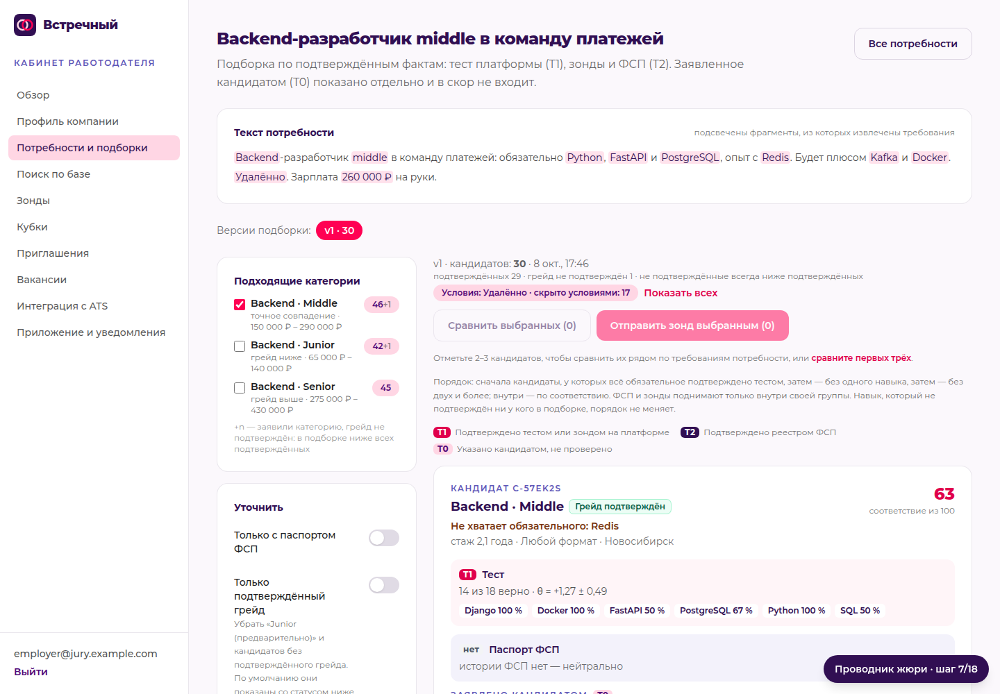
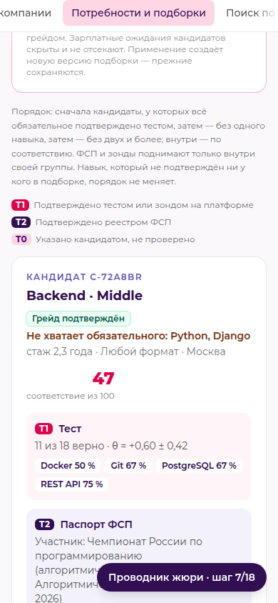

# Подбор: сначала покрывающие обязательное, условия потребности сразу (Ф2, 08.10)

Алгоритм `match-v1.1` = `match-v1` (те же веса и балл, `ranking.score_candidate`) + ярусы обязательного. Код —
`backend/app/modules/matching/must_have.py`, порядок — `ranking.build_selection`, разбор условий —
`need_parser.parse_conditions`. Тесты — `backend/tests/test_must_have.py`.

## Что видит жюри

- **Порядок подборки.** Сначала кандидаты, у которых всё обязательное подтверждено тестом (T1, доля ≥ 0,5), затем —
  без одного навыка, затем — без двух и более; внутри группы — прежний балл. Над списком — одна строка с этим правилом.
- **Шапка карточки:** «Не хватает обязательного: Python, FastAPI и ещё 1» (до трёх названий) или «Всё обязательное
  подтверждено тестом: 3 из 3». Подсказка: это не «не умеет» — тест навык не подтвердил, можно проверить зондом.
  Та же строка — в карточке кандидата, открытой из подборки.
- **Условия потребности применены сразу:** чип «Условия: Удалённо или офис/гибрид (Москва) · скрыто условиями: 17»
  и «Показать всех» — один клик создаёт новую версию без условий (прежняя сохраняется), обратно — «Применить условия».
  Кнопки «Подставить город и формат из потребности» больше нет; в «Уточнить» формат и город можно заменить явно.
- **Открытие сохранённой подборки** — без пересчёта пула: категории и условия берутся из снимка версии.

| 1440 | 390 |
|---|---|
|  |  |

Ещё снимки: [backend_remote_390](shots/backend_remote_390.png), [python_office_1440](shots/python_office_1440.png).
Горизонтальной прокрутки нет ни на 1440, ни на 390 (проверено в Chromium: `scrollWidth ≤ innerWidth`).

## Правило

1. Обязательный навык покрыт, если подтверждён заданиями теста (T1). Заявленное (T0) не покрывает.
2. Ярус = число непокрытых обязательных, которые **в пуле подборки подтверждены хоть у кого-то**: 0, 1, ≥ 2.
   «Нет данных» ≠ «не умеет»: навык, который не подтверждён ни у кого (тест его не проверяет или в пуле таких нет),
   ярус не меняет. Если обязательных нет или их не покрывает никто — порядок прежний.
3. Ярус статуса грейда старше: «грейд не подтверждён» — всегда ниже (как раньше).
4. ФСП и зонды входят в балл (до +0,15) и сравниваются только внутри яруса — через ярус не переносят.
5. Флаги окружения: `MATCH_MUST_FIRST=0` — прежний порядок `match-v1` (по умолчанию `1`);
   `MATCH_MUST_DECLARED=1` — засчитывать и заявленное «уверенно» (3 из 3 в опросе), если тест навык не проверял
   (по умолчанию `0`, см. ниже: на экспертных оценках этот вариант хуже).

## Условия потребности

- «Удалёнка или офис в Москве» = {удалённо} ∪ {офис или гибрид в Москве, или готов к переезду}. Город относится
  только к офису и гибриду; удалённый кандидат проходит из любого города.
- Отрицания: «кроме удалёнки», «без офиса», «удалёнка не рассматривается», «удалёнка — нет», «no office».
- «Любой формат» без исключений или формат не упомянут — условия нет. «Любой формат, кроме удалёнки» — офис/гибрид.
- «Казань или удалённо» — на месте в Казани или удалённо; «офис, 2 дня в неделю удалённо» — гибрид.
- «MS Office», «бэк-офис», «офисный пакет» — не формат; «гибридный график с офисом» — гибрид.
- Регрессия 50 вакансий (`tools/jury_match/regress_50.py`): формат 49 → 50 из 50, остальные поля не хуже.

## Метрики до/после

«До» — `match-v1` (тот же код, `MATCH_MUST_FIRST=0`), «после» — `match-v1.1`. Ни одного настраиваемого числа: правило
нормативное, ничего не подбиралось по меткам. В скобках — 95 % ДИ (бутстреп по потребностям).

| Набор | Метрика | До | После | Разница |
|---|---|---|---|---|
| Экспертные оценки v1 (10 потребностей, 109 пар, E1–E3, медиана) | p@5 | 0,66 | 0,66 | 0 |
| | nDCG@5 | 0,846 | 0,860 | +0,014 [0; 0,038], лучше 3, хуже 0 |
| | nDCG@5, вариант «заявленное уверенно» (флаг) | 0,846 | 0,837 | −0,009 [−0,041; 0,027], лучше 2, хуже 3 |
| `make bench` (200 × 2000, скрытая истина) | nDCG@10 | 0,580 | 0,583 | +0,003 [−0,003; 0,009] |
| | p@5 | 0,777 | 0,782 | +0,005 [−0,008; 0,018] |
| | MRR | 0,893 | 0,894 | +0,001 [−0,011; 0,014] |
| | топ-5: всё обязательное подтверждено | 0,325 | 0,380 | +0,055 [0,036; 0,077] |
| Скрытая истина 50 × 500 (guard) | nDCG@10 | 0,5776 | 0,5717 | −0,006 [−0,017; 0,004], p = 0,41 |
| | p@5 | 0,704 | 0,712 | +0,008 [−0,02; 0,04] |
| | MRR | 0,857 | 0,840 | −0,017 [−0,043; 0] |
| | топ-5: всё обязательное подтверждено | 0,184 | 0,228 | |
| Демо-500, разметка правилами (17 потребностей × 20) | p@5 | 0,840 | 0,840 | 0 |
| | nDCG@5 | 0,834 | 0,859 | +0,025 |
| | nDCG@10 | 0,893 | 0,915 | +0,022 |
| Демо-500, подборка как в продукте | топ-5: всё обязательное подтверждено (75 карточек) | 0,160 | 0,213 | |

Вывод. На экспертных оценках правило не хуже и в трёх потребностях лучше (N04, N05, N09), значимого ухудшения
нет — правило включено по умолчанию. Вариант с заявленным «уверенно» на экспертных оценках хуже в трёх
потребностях (N06, N12, N13) — оставлен за флагом, выключен. На мирах со скрытой истиной разница в пределах шума,
кроме доли топ-5 с подтверждённым обязательным (+0,055, ДИ не включает 0); MRR на 50 × 500 чуть ниже
(−0,017, верхняя граница ДИ 0) — честно фиксируем, на 200 × 2000 этого нет (+0,001). В основном бенчмарке
доля нерелевантных «раздутых» резюме в топ-10 0,045 → 0,051 (ярус ставит выше тех, у кого навык подтверждён, —
в том числе «раздутых», прошедших тест), второй мир nDCG@10 0,546 → 0,541 (ДИ пересекаются).

Источники: `docs/must_have/metrics.json` (эксперты, демо-500, 50 × 500), `docs/must_have/bench_before/` и
`docs/validation/MATCHING_BENCH.md` (раздел «Сначала покрывающие обязательное»), `docs/realdata/ranking_guard_500.json`.
Пакет экспертов — снимок карточек пакета A v1 с сервера (только чтение), оценки — E1–E3.

## Ranking guard: что поменялось и почему

`tools/realdata/ranking_guard.py` пересоздан: «до» — match-v1 без ярусов, «после» — продукт с ярусами
(раньше «после» было экспериментом И8 «меньше пробелов», выключенным). Эталон поменялся ожидаемо:

- Демо-500: порядок изменился у 7 из 17 потребностей — у тех, где обязательное подтверждено не у всех кандидатов
  категории: Java senior (гибрид, Петербург), Senior SOC, Бэкенд junior «Казань или удалённо», QA middle,
  Go senior, Junior frontend (Томск), Автоматизатор senior. nDCG@10 по правилам вырос у всех семи.
- Демо-500 «до» отличается от прежнего эталона (p@5 0,893 → 0,840): с И18 изменился разбор потребностей, а «Казань
  или удалённо» теперь допускает офис в Казани (метка формата у офисных кандидатов больше не снижается); выборка
  20 кандидатов на потребность идёт по общему генератору случайных чисел, поэтому смещается и у следующих потребностей.
- Скрытая истина 50 × 500: топ-10 изменился у 42 из 50 потребностей; итог — в таблице выше. Вариант И8
  (число пробелов без ярусов и без проверки «подтверждён ли у кого-то») даёт nDCG@10 0,5709 — ярусы чуть лучше.

## Пересчёт

```
cd backend
LLM_DISABLED=1 ../../.venv/bin/python ../tools/must_have/evaluate.py      # → docs/must_have/metrics.json
LLM_DISABLED=1 ../../.venv/bin/python ../tools/realdata/ranking_guard.py  # → docs/realdata/ranking_guard_500.json
make bench MATCH_MUST_FIRST=0   # «до»;  make bench — «после» (на сервере проверок: spectrek/bin/remote-make … bench)
```

## Ограничения

- Ярусы 0 / 1 / ≥ 2 по карточке: в потребности с 4–5 обязательными, где почти у всех не хватает двух и больше,
  порядок почти не меняется — зато строка «Не хватает обязательного: …» в шапке показывает пробелы сразу.
- Условия жёстче прежнего: офисная потребность в Самаре на демо-мире показывает 5 подтверждённых, 26 скрыты условиями
  (чип и «Показать всех» рядом). Песочница жюри (удалённо, Москва) в «Офис в Москве» скрыта условиями.
- Снимок версии хранится в `filters._meta` без миграции; у версий до Ф2 снимок досчитывается при первом открытии.
