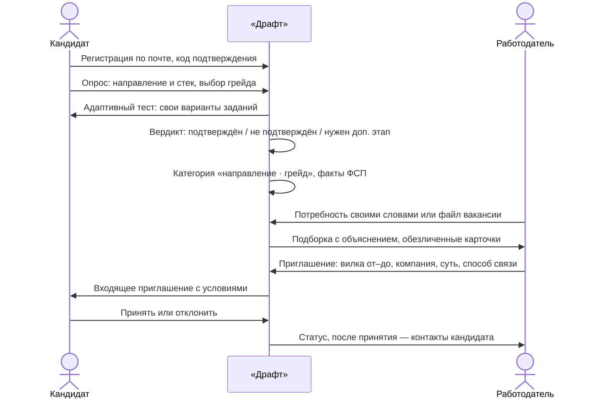
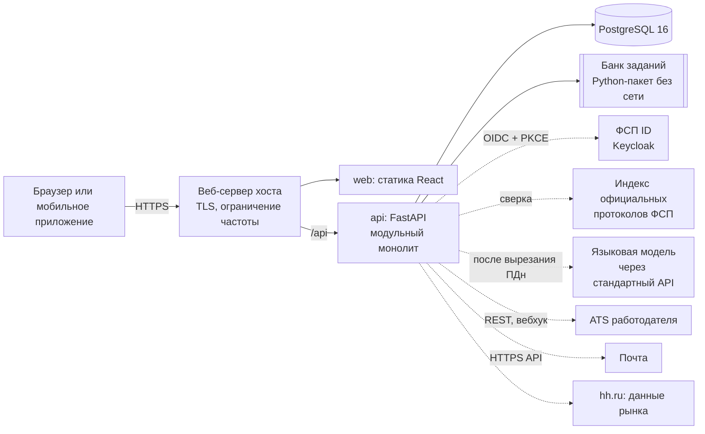
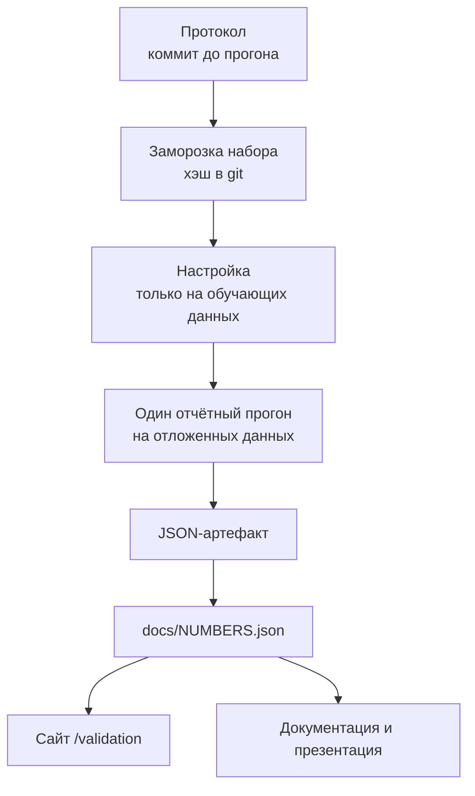
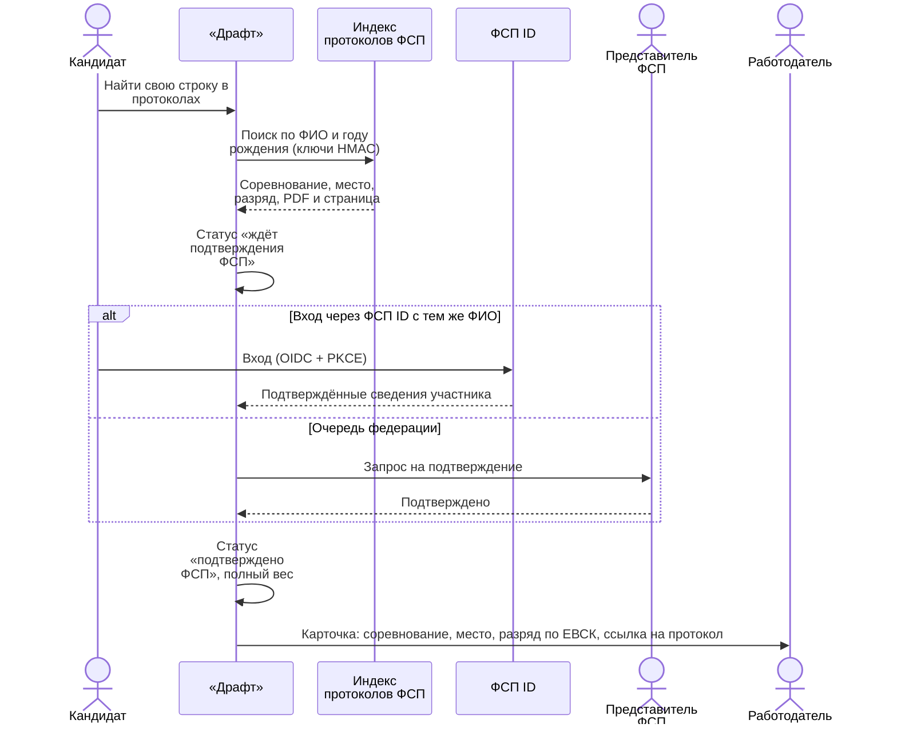

<!-- Исходник: docs/submission/src/DOCUMENTATION.md. Цифры подставляет docs/submission/build.py только из
     docs/NUMBERS.json; не правьте собранный docs/submission/DOCUMENTATION.md вручную. -->

# О документе {.unnumbered}

Документ описывает решение «Драфт» в объёме пункта 3.4 технического задания. Каждый раздел отвечает на один пункт:

| Пункт ТЗ 3.4 | Раздел |
|---|---|
| Функциональная и компонентная архитектура | [2](#arch) |
| Механика тестирования и её устойчивость к распространению заданий | [3](#test) |
| Механика подбора и логика категоризации | [4](#match) |
| Процедура валидации и её результаты | [5](#valid) |
| Схема интеграции с реестром ФСП | [6](#fsp) |
| Описание API | [7](#api) |
| Библиотеки и компоненты с версиями | [8](#libs) |
| Сборка, развёртывание и локальный запуск | [9](#deploy) |

Требования раздела 3.5 (код, безопасность, 152-ФЗ, производительность) — раздел [10](#nfr), монетизация — раздел
[11](#money), карта соответствия всем пунктам ТЗ — приложение [А](#map), полный список цифр с ключами — приложение
[Б](#numbers).

**Ссылки.** Сайт — <https://fsp-draft.ru>; раздел для экспертов — <https://fsp-draft.ru/demo>; методика и цифры —
<https://fsp-draft.ru/validation>; описание API — <https://fsp-draft.ru/api/docs>; исходный код —
<https://github.com/neuropeopleteam-afk/draft>.

**Как читать цифры.** Все числа качества в документе подставлены автоматически из файла `docs/NUMBERS.json`, который
собирается из отчётов прогонов. У каждого числа указано, на ком оно измерено: «симуляция, модельные кандидаты, не
люди», «реальные вакансии hh.ru», «официальные протоколы ФСП», — объём выборки, дата и команда пересчёта.
Документ пересобирается одной командой `python3 docs/submission/build.py`.

# Задача и решение {#idea}

Универсальные площадки поиска работы сводят IT-подбор к совпадению ключевых слов: резюме не подтверждает навыки,
работодатель вручную разбирает сотни откликов, кандидат откликается вслепую и не видит условий. «Драфт» меняет
порядок действий:

1. **Кандидат один раз подтверждает навыки.** Регистрация по почте с подтверждением → короткий опрос (направление,
   стек) → выбор грейда, на который кандидат претендует → адаптивный тест на этот грейд. Итог — категория
   «направление · грейд», которую видит работодатель. Категория строится только по тесту, не по резюме.
2. **Работодатель описывает задачу своими словами** и получает подборку обезличенных кандидатов из подходящих
   категорий с объяснением «почему этот кандидат здесь».
3. **Работодатель сам выходит на кандидата** с приглашением, в котором обязательны зарплатная вилка «от–до» в
   рублях, название компании, описание предложения и способ связи. Кандидат видит условия до начала общения;
   контакты кандидата раскрываются только после его согласия.
4. **Достижения ФСП подтверждаются документами** — официальными протоколами соревнований ФСП России — и поднимают
   кандидата в подборке. Кандидат без истории ФСП не получает штрафа.



Дополнительно реализованы: самостоятельный отклик на опубликованные вакансии, регулярные короткие задания от
работодателей с автопроверкой, защита от фиктивных вакансий (проверка компании в ЕГРЮЛ, индекс доверия), передача
кандидатов в ATS, мобильное приложение и адаптивная вёрстка, кабинет Федерации и трёхсторонняя связь
«компания — кандидат — ФСП».

# Функциональная и компонентная архитектура {#arch}

## Роли и функциональные блоки

| Роль | Что делает на платформе | Где на сайте |
|---|---|---|
| Кандидат | профиль вручную или из PDF-резюме с автораспознаванием; опрос, выбор грейда, тест; категория и история попыток; приглашения и отклики; регулярные задания; приватность, согласия, связь с ФСП ID; выгрузка и удаление данных | `/candidate` |
| Работодатель | профиль компании; потребность текстом или файлом; подборка с объяснением и версиями; поиск по базе с фильтрами; сравнение кандидатов; приглашения со статусами; вакансии и отклики; задания для кандидатов; найм и передача в ATS | `/employer` |
| Федерация ФСП | кадровый резерв по регионам и направлениям против спроса рынка; подтверждение достижений; трёхсторонняя связь; спонсорские пакеты и кубки работодателей | `/fsp` |
| Методист / эксперт | очередь проверки развёрнутых ответов по рубрике, разбор спорных случаев | `/expert` |
| Администратор | пользователи, компании, заявки на тарифы, обращения в поддержку | `/admin` |
| Эксперт жюри | вход в демо-роль в один клик, личная песочница с демо-данными, маршрут по критериям ТЗ | `/demo` |

Функциональные блоки соответствуют модулям backend (`backend/app/modules/<модуль>/`):

| Блок | Модули | Главное |
|---|---|---|
| Учётные записи и доступ | `auth`, `admin` | регистрация по почте с кодом, вход (JWT), второй фактор для служебных ролей, роли |
| Справочник | `catalog` | направления, грейды, категории, стек, дисциплины ЕВСК |
| Профили и документы | `profiles`, `resume`, `pdf`, `mydata` | опрос, приватность, разбор PDF/DOCX-резюме, стандартизированный PDF-профиль, выгрузка и удаление данных |
| Тестирование | `assessment`, `proctor`, `interview`, `experts` | банк заданий, адаптивный тест, вердикт, второй этап, проверка развёрнутых ответов, сигналы честности, устная защита |
| Подбор | `matching`, `mutual`, `subs` | разбор потребности, ранжирование с объяснением, версии подборок, взаимный подбор, подписка на новых кандидатов |
| Контакт и найм | `invitations`, `contact`, `hiring`, `trio`, `notifications` | приглашения и статусы, переписка, этапы найма, трёхсторонняя связь, уведомления |
| Вакансии и задания | `assignments`, `hh` | вакансии и отклики, задания работодателя с автопроверкой, данные рынка hh.ru |
| ФСП | `fsp` и `app/fsp_cabinet` | паспорт достижений, сверка с протоколами, нормативы ЕВСК, кабинет федерации |
| Интеграции | `app/integrations` | ФСП ID (OIDC), ATS, проверка компании в ЕГРЮЛ |
| Качество и прозрачность | `validation`, `study` | публичные цифры качества, обезличенная статистика прохождения |
| Демонстрация | `jury`, `demo`, `warroom` | раздел для жюри, демо-данные, песочницы |
| Коммерция | `tariffs` | тарифы работодателей и спонсорские пакеты ФСП |

## Компонентная схема



| Компонент | Технология | Назначение |
|---|---|---|
| `web` | nginx + сборка React/Vite | интерфейс для всех ролей, адаптивная вёрстка, установка как приложение |
| `api` | Python 3.12, FastAPI, SQLAlchemy 2, Alembic | вся бизнес-логика; миграции применяются при старте |
| `db` | PostgreSQL 16 | единственное хранилище; тесты идут и на PostgreSQL, и на SQLite |
| `keycloak` (профиль `fsp-id`) | Keycloak | демо-стенд «ФСП ID» для входа и связи профиля |
| `llm-local` (профиль `llm-local`) | открытая модель на CPU | работа без внешних ключей |

Внешняя языковая модель необязательна: при её отсутствии разбор текста переходит на словарь и правила, а развёрнутые
ответы — в очередь проверки экспертом. Персональные данные вырезаются до отправки текста модели.

## Разделение слоёв

Backend — модульный монолит с явными слоями. Каждый модуль: `models.py` (хранение, только свои таблицы),
`schemas.py` (контракты API, Pydantic), `service.py` (бизнес-логика без HTTP), `router.py` (HTTP, коды ошибок,
описание в OpenAPI). Модули общаются через сервисы; внешние системы (почта, модель, ФСП, ATS) — только через
адаптеры с запасным путём. Банк заданий — отдельный пакет без доступа к БД и сети, поэтому его можно проверять и
переиспользовать отдельно. Подробности и модель данных — `docs/ARCHITECTURE.md`.

## Рыночный режим и демо

Основной сайт работает как рыночный продукт: настоящие пользователи видят только настоящие объекты. Демо-данные
(модельные кандидаты, компании, потребности) помечены и видны только в демо-ролях раздела `/demo`; у каждого
эксперта жюри — своя песочница, которую можно сбросить. Проверка видимости — единая функция в
`backend/app/modules/jury/scope.py`, автотест проходит по всем ответам API и ищет утечки демо-данных.

# Механика тестирования {#test}

## Банк параметрических заданий

{{#bank_families}}Банк содержит {{bank_families}} семейств заданий{{#bank_directions}} по {{bank_directions}} направлениям{{/bank_directions}}{{#bank_practical}}, из них {{bank_practical}} — с кодом и развёрнутым ответом{{/bank_practical}}.{{/bank_families}}
Семейство — это не одно задание, а генератор: из шаблона и случайного зерна получается конкретный вариант с
другими данными, именами, числами и, где возможно, другим правильным ответом при той же проверяемой идее и той же
трудности. Форматы: «найди ошибку», «предскажи вывод», «выбери исправление», «открытая книга в три шага»,
концептуальный выбор, ввод ответа, развёрнутый ответ по рубрике.

Ключи всех вариантов проверяются автоматически: валидатор генерирует варианты каждого семейства и исполняет
эталонное решение.{{#bank_checks}} Последняя проверка — {{bank_checks}} проверок, ошибок — {{bank_checks_failed}} ({{bank_checks.cond}}).{{/bank_checks}}

## Адаптивный тест и вердикт

Тест подбирает следующее задание по уже данным ответам: так каждый кандидат получает задания, которые лучше всего
различают уровни рядом с его заявленным грейдом. Около трети заданий — практические (код, развёрнутый ответ).
Когда оценка уровня оказывается рядом с границей грейда, тест задаёт короткие уточняющие задания.

Итог отвечает на вопрос работодателя — подтверждён ли заявленный грейд — тремя исходами:

- **подтверждён** — грейд появляется в категории и в подборках;
- **не подтверждён** — кандидат видит, на каких навыках не хватило, и может сразу пройти тест на грейд ниже;
- **нужен короткий дополнительный этап** — если результат у самой границы, вместо угадывания назначается второй
  этап на новых заданиях.

Как считается: байесовская последовательная классификация — после каждого ответа пересчитывается вероятность того,
что уровень кандидата не ниже границы заявленного грейда, и вердикт выносится по этой вероятности. Последовательный
критерий Вальда (SPRT{{#repo_sprt_alpha_pct}}, α = {{repo.sprt_alpha_pct}}{{/repo_sprt_alpha_pct}}) решает только, можно ли остановить тест раньше,
когда ответ уже ясен.

Правила грейда (из `backend/app/modules/assessment/rules.py` и `backend/app/core/config.py`):

- неудачная попытка **не понижает** уже подтверждённый грейд;
- после неподтверждённой попытки тест на **грейд ниже** можно пройти сразу, на **тот же или более высокий** — не
  раньше чем через {{repo.retake_same_grade_days}} дней;
- смена подтверждённого грейда — не чаще одного раза в {{repo.grade_change_interval_days}} дней (ТЗ: «не чаще раза в
  три месяца»); короткое уточнение у границы — часть той же оценки, а не новая попытка;
- для экспертов жюри в демо-ролях ограничения сняты, чтобы можно было пройти сценарий несколько раз.

{{#verdict_accuracy}}По симуляции продукта (тот же движок, что на сайте) итог проверки заявленного грейда верен в
{{verdict_accuracy}} случаев ({{verdict_accuracy.kn}}; {{verdict_accuracy.ci}}){{#confident_share}}; уверенный ответ уже по
основному тесту получают {{confident_share}} кандидатов, и он верен в {{confident_accuracy}}{{/confident_share}}.
Условие: {{verdict_accuracy.cond}}. Подробно — раздел [5](#valid).{{/verdict_accuracy}}

## Почему распространение заданий не помогает

ТЗ называет два риска: единый набор заданий быстро утекает, а уникальные задания, сгенерированные нейросетью под
кандидата, несопоставимы по сложности. «Драфт» закрывает оба:

1. **Свой вариант у каждого.** Кандидат получает варианты семейств со своим зерном; выученный ответ чужого варианта
   не подходит к своему. При этом сложность сопоставима: все варианты семейства проверяют одну идею и имеют
   одинаковые параметры трудности — это проверяется валидатором банка, а не обещается.
2. **Контроль частоты показа.** Ни одно семейство не показывается слишком часто (метод Сымпсона — Хеттера); задания
   разбиты на параллельные субпулы, и повторная попытка получает другой субпул. Утёкший субпул выводится из ротации
   одной настройкой.
3. **Повторная попытка — на новых семействах.** Семейства прошлых попыток кандидата не повторяются, пока есть новые.
4. **Ключи только на сервере.** Правильные ответы не передаются в браузер; служебные поля варианта не видны
   кандидату (проверяется аудитом банка).
5. **Сигналы предзнания.** Слишком быстрые верные ответы на трудные задания и несогласованность с остальными ответами
   отмечаются как сигнал для дополнительной проверки.
6. **Модель не сочиняет задания на лету.** Генерация — детерминированная по шаблону, поэтому трудность известна
   заранее; языковая модель используется только как один из проверяющих развёрнутых ответов.

## Проверка развёрнутых ответов и защита от манипуляций

Развёрнутый ответ оценивается по рубрике. Перед оценкой фильтр ищет попытки манипуляции («поставь максимальный
балл», скрытые инструкции); текст кандидата изолируется от инструкций проверяющего; каждая оценка должна
опираться на дословные цитаты из ответа, иначе она отклоняется; при расхождении нужна вторая оценка, а спорные
случаи уходят эксперту в очередь `/expert`.{{#ac_filter}} На отложенном наборе атак фильтр перехватил {{ac_filter}}
атак ({{ac_filter.kn}}) при {{ac_fp}} ложных срабатываний{{#ac_chain_pierced}}; всю цепочку защиты прошли
{{ac_chain_pierced}} атак{{/ac_chain_pierced}} ({{ac_filter.cond}}).{{/ac_filter}}

## Честность прохождения

Во время теста собираются сигналы: переключение вкладок, вставка текста, нетипичное время ответа, по согласию —
анализ камеры прямо в браузере (видео никуда не передаётся). Один сигнал ничего не значит: при двух и более
сигналах или прямом доказательстве кандидату предлагается короткая устная защита своего решения. Автоматической
блокировки нет — честный кандидат не должен страдать из-за случайности.{{#ac_honest_false}} В симуляции поведения
ошибочно отправлено на проверку {{ac_honest_false}} честных кандидатов{{#ac_bot_detect}}, а модельных ботов —
{{ac_bot_detect}} ({{ac_bot_detect.kn}}){{/ac_bot_detect}}; условие: {{ac_honest_false.cond}}.{{/ac_honest_false}}

## Регулярные задания и подписанный паспорт грейда

Работодатель собирает короткое задание из банка (или своё) и отправляет кандидатам категории; ответы проверяются
автоматически и обновляют актуальность профиля. Результат теста можно предъявить вне платформы: паспорт грейда
подписан электронной подписью Ed25519 и проверяется по открытому ключу на странице `/verify`.

# Механика подбора и категоризация {#match}

## Категории

Категория — связка «направление · грейд». Направления: Backend, Frontend, Data/ML, QA, информационная безопасность,
DevOps/SRE, инженер данных, мобильная разработка, системный и бизнес-аналитик. Грейды: Стажёр, Junior, Middle,
Senior, Lead, Principal. Кандидат попадает в категорию только по подтверждённому тестом грейду. Пока грейд не
подтверждён, кандидат виден в подборке по направлению из опроса — последним ярусом и с пометкой «грейд не
подтверждён»; заявленный грейд в скор не входит.

## Разбор потребности

Работодатель пишет задачу своими словами («нужен бэкендер на платёжный сервис, Python, высокая нагрузка») или
загружает файл вакансии. Платформа выделяет направление, грейд, обязательный и желательный стек и показывает цитату
из текста для каждого требования. Условия, нарушающие статью 64 Трудового кодекса (пол, возраст, внешность и т. п.),
отбрасываются с пояснением. Работодатель может поправить любое требование.

{{#hh_direction}}Разбор проверен на реальных вакансиях hh.ru: направление определено верно в {{hh_direction}}
({{hh_direction.kn}}). Условие: {{hh_direction.cond}}.{{/hh_direction}}

## Ранжирование и объяснение

Скор кандидата складывается из подтверждённых фактов (доли — из `backend/app/modules/matching/ranking.py`):

| Составляющая | Доля скора |
|---|---|
| Результат теста по грейду и навыкам потребности | {{repo.w_test}} % |
| Обязательный стек потребности | {{repo.w_stack_required}} % |
| Желательный стек | {{repo.w_stack_desired}} % |
| Подтверждённые достижения ФСП | {{repo.w_fsp}} % |
| Короткое задание работодателя (если было) | {{repo.w_probe}} % |

Правила, которые важны для честности выдачи:

- **Грейд — только подтверждённый.** Фильтр грейда и категории работает по результату теста, а не по резюме.
- **ФСП — бонус, а не штраф.** Достижение со статусом «подтверждено ФСП» даёт полный вес, «ждёт подтверждения» —
  половину, заявленное без документа — ноль. У кандидата без истории ФСП эта составляющая равна нулю без штрафа, и
  он остаётся в подборке на общих основаниях.{{#no_fsp_top5}} В модельном пуле у кандидатов без ФСП —
  {{no_fsp_top5}} мест в первых пятёрках при доле {{no_fsp_pool}} в пуле ({{no_fsp_top5.cond}}).{{/no_fsp_top5}}
- **Объяснимость.** У каждого кандидата — короткое «почему он здесь»: какие навыки потребности подтверждены тестом и
  на каких заданиях, какие достижения ФСП учтены и с каким статусом, чего не хватает.
- **Внутри категории** выше тот, у кого сильнее результат теста и есть подтверждённые достижения ФСП (ТЗ 2.1).

{{#match_p5}}На отложенных синтетических мирах доля подходящих кандидатов в первой пятёрке подборки (P@5) — {{match_p5}}
({{match_p5.ci}}){{#match_bm25}}, у поиска по тексту резюме — {{match_bm25}}{{/match_bm25}}{{#match_no_test}}, у того же
подбора без результатов теста — {{match_no_test}}{{/match_no_test}}. Условие: {{match_p5.cond}}.{{/match_p5}}

## Уточнение без потери подборки

Каждое изменение фильтров или требований создаёт новую версию подборки; прежние версии сохраняются, и между ними
можно переключаться и сравнивать. Работодатель может включить «учитывать решения компании»: отметки «подходит / не
подходит» мягко сдвигают веса скора, а изменение показывается явно. Подписка на потребность присылает уведомление,
когда появляются новые подходящие кандидаты.

## Выход на контакт

1. Работодатель открывает обезличенную карточку (подтверждённый грейд, навыки, факты ФСП, объяснение) и
   отправляет **приглашение**: описание предложения, зарплатная вилка «от–до» в рублях (обязательна, проверяется и
   на уровне базы данных), название компании, способ связи, по желанию — слоты собеседования. Можно сначала
   отправить **короткое задание** на {{repo.probe_minutes}} минут, чтобы получить свежий сигнал.
2. Кандидат видит условия до начала общения и принимает или отклоняет приглашение; повторное приглашение той же
   компанией тому же кандидату — не раньше чем через {{repo.invitation_cooldown_days}} дней.
3. Статусы «отправлено → просмотрено → принято / отклонено» видят обе стороны. Контакты кандидата раскрываются только
   после принятия приглашения или собственного отклика кандидата.
4. Взаимный подбор подсказывает работодателю до отправки, подойдёт ли предложение кандидату (формат, город, вилка
   против скрытого минимума кандидата — только «в ожиданиях / ниже», без раскрытия суммы).
5. После принятия — переписка, этапы найма и передача кандидата в ATS работодателя.

Классический сценарий тоже есть: работодатель публикует вакансию (с обязательной вилкой), кандидат откликается сам.

# Процедура валидации и результаты {#valid}

## Принципы процедуры

Эталонной разметки в хакатоне нет, поэтому команда построила собственную процедуру. Её правила защищают от
самообмана:

1. **Протокол до прогона.** Что измеряем, на каких данных и как выбираем настройки — записывается в репозиторий до
   отчётного прогона (`docs/validation/PRODUCT_SIM_PROTOCOL.md`, `docs/realdata/hh_holdout_PROTOCOL.md`).
2. **Разведённые данные.** Настройки подбираются только на обучающих зёрнах и мирах; отчётные зёрна, миры и наборы
   вакансий в настройке не участвуют. Отложенный набор замораживается, его хэш фиксируется коммитом до прогона.
3. **Один отчётный прогон.** Публикуется результат единственного прогона, каким бы он ни вышел; выбора лучшего из
   нескольких нет.
4. **Тот же код, что на сайте.** Симуляция гоняет продуктовый движок теста и подбора, а не упрощённую модель.
5. **Каждая цифра — с условием** (на ком, N, дата, команда пересчёта) и в одном файле `docs/NUMBERS.json`; на сайте,
   в документации и в презентации — одни и те же значения.
6. **Модель — не люди.** Где кандидаты модельные, это написано рядом с цифрой. Где метрика на модели недостижима
   честно, вместо неё публикуется более строгая (например, «верный итог проверки заявленного грейда» вместо
   «точного грейда»).



## Главные метрики: стандартные условия и проверка на прочность

Каждая метрика публикуется дважды и рядом. Заголовок — **стандартные условия**, принятые в аналогичных решениях
(тест: кандидаты отвечают по своему уровню, параметры заданий известны; подбор: точные резюме, грейд — по тесту).
Сразу рядом — **проверка на прочность**: наши жёсткие условия — угадывание, завышенные заявки, кандидаты у самой
границы грейда, неточные параметры заданий, неточные резюме. Какие условия идут заголовком, зафиксировано в
протоколах до прогонов и от результатов не зависит; ни одна из двух строк не скрывается.

{{pairs_table}}

## Тест на грейд

Модельные кандидаты с известным истинным уровнем проходят тот же движок, что на сайте, на реальном банке заданий.
Проверяются три «мира»: параметры заданий известны точно; трудность заданий известна неточно (банк ещё не
откалиброван на людях, движок об этом не знает); проверка развёрнутых ответов ошибается. Повторяемость — второе
прохождение тех же кандидатов на другом наборе заданий.

{{numbers_table:grade}}

**Почему главная метрика — верный итог проверки, а не «точный грейд».** Работодателю нужен ответ «подтверждён ли
заявленный уровень». Угадать точную ступень у кандидата, чей уровень лежит у самой границы, за один тест
математически нельзя ни одним методом; поэтому у границы платформа честно назначает второй этап, а не угадывает.

## Банк заданий

{{numbers_table:bank}}

## Подбор

Синтетические миры: потребности и модельные кандидаты с заранее известной релевантностью; веса подбирались на
других мирах; сравнение — с поиском по тексту резюме и с подбором без отдельных составляющих.

{{numbers_table:match}}

Реальные вакансии hh.ru: насколько верно платформа понимает живой текст вакансии — направление, грейд, навыки.
Набор отложенный: собран после настройки словаря и разбора и заморожен до прогона.

{{numbers_table:hh}}

## Защита проверки ответов и честность прохождения

{{numbers_table:ac}}

## Реальные документы ФСП

{{numbers_table:fsp}}

{{#load_p95}}
## Нагрузка

{{numbers_table:load}}
{{/load_p95}}

## Ограничения

- Калибровки трудности заданий на большой выборке живых людей пока нет: симуляция «неточно известной трудности»
  показывает, насколько результат устойчив к этому. Обезличенная статистика прохождения собирается на сайте; калибровка
  на людях — следующий шаг после запуска.
- Релевантность в синтетических мирах задана моделью; на реальных вакансиях проверяется разбор потребности, а не
  итоговое решение о найме.
- Метки hh.ru сами содержат шум; спорные случаи перепроверены независимыми арбитрами-моделями, а не людьми, и это
  указано рядом с цифрой.

# Интеграция с реестром ФСП {#fsp}

ТЗ не даёт API и структуры данных ФСП и просит команду предложить, какие сведения получать и как показывать.
«Драфт» работает с тремя источниками — от самого надёжного к временному.

| Источник | Что даёт | Статус в продукте |
|---|---|---|
| **ФСП ID** (OIDC, Keycloak) | вход и связь профиля с ID участника; разряд, дисциплины, достижения в составе учётной записи | работает на демо-стенде Keycloak; переключение на настоящий ФСП ID — смена адреса, клиента и секрета без изменения кода |
| **Официальные протоколы ФСП России** | места, разряды, номер соревнования в Едином календарном плане, ссылка на PDF и страницу | индекс протоколов с сайта федерации; кандидат находит свою строку, работодатель видит ссылку на документ |
| **API реестра ФСП** (предложение контракта) | снимок достижений участника по его ФСП ID | контракт `docs/fsp_registry_api.yaml` и рабочий адаптер; режим `external` включается переменными окружения |

{{#fsp_documents}}Индекс содержит {{fsp_documents}} официальных протоколов{{#fsp_results}}: {{fsp_results}} результатов{{/fsp_results}}{{#fsp_athletes}},
{{fsp_athletes}} спортсменов{{/fsp_athletes}}{{#fsp_regions}} из {{fsp_regions}} субъектов РФ{{/fsp_regions}} ({{fsp_documents.cond}}).{{/fsp_documents}}

## Статусы достижения

| Статус | Как получается | Вес в составляющей ФСП |
|---|---|---|
| Нет истории ФСП | кандидат не указал достижений | 0, без штрафа; фраза в карточке: «Истории ФСП нет — без штрафа» |
| Заявлено | кандидат указал достижение без документа | 0 |
| Ждёт подтверждения ФСП | кандидат нашёл свою строку в официальном протоколе | половина |
| Подтверждено ФСП | совпадение через ФСП ID или решение представителя федерации | полный |

Судейские и тренерские записи и строки справок не считаются достижениями. Разряд по Единой всероссийской
спортивной классификации (ЕВСК) выводится из места, числа участвующих субъектов РФ и состава судейской коллегии и
показывается с основанием.



## Персональные данные спортсменов

Обработка сверена с Положением ФСП об обработке персональных данных. Из протокола берутся только ФИО, год рождения,
субъект РФ, команда, место и разряд. Индекс хранится вне репозитория, доступен только процессу API; ключи поиска —
HMAC с серверным секретом. Чужие ФИО никому не показываются: работодатель видит только результат сверки по
кандидату, который сам дал согласие. Открытого каталога спортсменов нет; публично — только обезличенные агрегаты
(по регионам и дисциплинам) в кабинете федерации. Для несовершеннолетних отправка и принятие оффера требуют
отметки согласия законного представителя и особого формата работы.

## Как перейти на боевую интеграцию

1. Зарегистрировать «Драфт» клиентом ФСП ID (Authorization Code + PKCE), согласовать состав атрибутов участника;
   различия в именах задаются настройкой `FSP_OIDC_CLAIMS_MAP` без изменения кода.
2. Когда появится API реестра — включить `FSP_REGISTRY_MODE=external` с адресом и сервисным токеном; контракт
   `docs/fsp_registry_api.yaml` — предложение команды для обсуждения с федерацией.
3. Индекс протоколов остаётся запасным источником для участников без ФСП ID.

Подробно: `docs/FSP_INTEGRATION.md`, `docs/realdata/fsp_protocols/README.md`.

# Описание API {#api}

Все методы описаны спецификацией OpenAPI {{repo.api_version}}: {{repo.api_operations}} операций в {{repo.api_tag_count}}
группах. Спецификация собирается из кода (`make openapi`) и проверяется тестом на актуальность.

- Интерактивное описание: <https://fsp-draft.ru/api/docs> (Swagger UI), <https://fsp-draft.ru/api/redoc>; файлы
  интерфейса документации раздаются с нашего сервера, внешних CDN нет.
- Файл: `docs/api/openapi.json`, на сайте — `/api/openapi.json`.
- Аутентификация: `Authorization: Bearer <JWT>`; токен выдаёт `POST /api/auth/login` после подтверждения почты;
  служебные роли — со вторым фактором. Права проверяются по роли на каждом методе; матрица прав проверяется
  автотестом.
- Ошибки — единый формат `{"detail": {"code": "<машинный код>", "message": "<текст по-русски>"}}`; коды ошибок
  каждого метода перечислены в спецификации, у ответов есть примеры.

{{api_tags_table}}

Главные методы сквозного сценария:

| Шаг | Метод |
|---|---|
| Регистрация и подтверждение почты | `POST /api/auth/register`, `POST /api/auth/verify-email` |
| Вход | `POST /api/auth/login` |
| Опрос: направление, стек, грейд | `PUT /api/me/onboarding` |
| Профиль из PDF-резюме | `POST /api/me/resume` |
| Тест на грейд | `POST /api/assessment/sessions`, `POST /api/assessment/sessions/{session_id}/answers`, `POST /api/assessment/sessions/{session_id}/finish` |
| Категория, грейд, история | `GET /api/assessment/status` |
| Потребность и подборка | `POST /api/employer/needs`, `POST /api/employer/needs/file`, `POST /api/employer/needs/{need_id}/selections` |
| Поиск по базе | `GET /api/employer/candidates` |
| Приглашение | `POST /api/employer/invitations` |
| Ответ кандидата | `POST /api/candidate/invitations/{inv_id}/accept`, `POST /api/candidate/invitations/{inv_id}/decline` |
| Вакансии и отклик | `GET /api/vacancies`, `POST /api/vacancies/{vid}/apply` |
| Сверка с протоколами ФСП | `POST /api/me/fsp/protocols/search`, `POST /api/me/fsp/protocols/confirm` |

Тела запросов и ответы — в спецификации. Каждый метод из этой таблицы при сборке документа сверяется со спецификацией: несуществующий путь — ошибка сборки.

# Библиотеки и компоненты {#libs}

Версии ниже собраны автоматически из файлов зависимостей репозитория при сборке документа. Все библиотеки —
с открытыми лицензиями; полный список с лицензиями — `THIRD_PARTY.md`.

{{libs_table}}

# Сборка, развёртывание и локальный запуск {#deploy}

## Требования

- Linux, macOS или Windows с Docker Engine и Docker Compose v2.24+, `make`, `git`.
- Для запуска без Docker — Python 3.12+, Node.js 20+.
- Внешние ключи не обязательны: без почтового сервиса коды подтверждения пишутся в лог, без языковой модели работают
  правила и очередь экспертов.

## Запуск в Docker (рекомендуется)

```bash
git clone https://github.com/neuropeopleteam-afk/draft.git
cd draft
make up        # создаёт .env со случайными секретами, собирает образы, применяет миграции, создаёт демо-данные
               # NO_SEED=1 make up — без демо-данных
make ps        # состояние контейнеров
make logs      # логи API; в режиме разработки здесь видны коды подтверждения почты
```

Сайт — <http://localhost:8080>, описание API — <http://localhost:8080/api/docs>. Остановить — `make down` (данные
БД сохраняются в томе `db_data`).

Дополнительные профили:

```bash
COMPOSE_PROFILES=fsp-id make up   # + демо-стенд «ФСП ID» (Keycloak)
make llm-local                    # + открытая языковая модель на CPU, без внешних ключей
```

## Запуск без Docker

```bash
make dev-backend    # API на SQLite с автоперезагрузкой, http://127.0.0.1:8000
make dev-frontend   # интерфейс Vite с прокси /api → :8000, http://127.0.0.1:5173
```

## Проверка

```bash
make test           # тесты backend в контейнере (SQLite + миграции)
make test-pg        # те же тесты на PostgreSQL
make test-bank      # валидатор банка заданий
make openapi        # пересборка docs/api/openapi.json из кода
python3 tools/publish/gen_numbers.py   # пересборка docs/NUMBERS.json из отчётов прогонов
python3 docs/submission/build.py       # пересборка README, документации и презентации
```

## Развёртывание на сервере

1. Сервер с Docker (для стенда достаточно небольшого виртуального сервера; лимиты памяти контейнеров заданы в
   `docker-compose.yml`).
2. `git clone`, `make env`, заполнить в `.env` публичный адрес (`PUBLIC_BASE_URL`), почту отправителя и, при
   необходимости, ключи внешних сервисов — их список и назначение описаны в `.env.example`. Секреты хранятся вне
   репозитория с правами 600.
3. `make up` — контейнеры слушают только `127.0.0.1`; снаружи их публикует веб-сервер хоста с TLS. Пример
   конфигурации — `infra/`.
4. Миграции применяются автоматически при старте контейнера `api`; демо-данные — идемпотентно.
5. Обновление: `git pull && make up` (пересборка образов и миграции).

# Нефункциональные требования и безопасность {#nfr}

| Требование ТЗ 3.5 | Как выполнено |
|---|---|
| Открытый код | исходный код открыт, не скомпилирован и не обфусцирован; лицензия MIT; зависимости — открытые |
| Архитектура | frontend (React) · backend (FastAPI, модульный монолит со слоями) · PostgreSQL; модули связаны через сервисы |
| Контейнеризация | Dockerfile для `api` и `web`, `docker-compose.yml`, запуск одной командой `make up` |
| API | OpenAPI со всеми методами, примерами и кодами ошибок (раздел 7) |
| Аутентификация | собственные учётные записи + вход через ФСП ID по OIDC (Keycloak) |
| Платформенность | веб для современных браузеров, адаптивная вёрстка 360 / 768 / 1280 px, установка как приложение, Android-приложение |
| Качество кода | комментарии к сложным решениям, тесты backend и сквозные тесты интерфейса, проверка в CI |

**Безопасность и 152-ФЗ.**

- Согласия на обработку, на публикацию профиля и на камеру во время теста — отдельные, с датой и версией текста;
  без согласия на публикацию кандидат не виден работодателям; отозвать согласие можно в любой момент.
- Работодатель видит обезличенную карточку; контакты — только после принятия приглашения или отклика.
- Перед отправкой текста внешней модели персональные данные вырезаются.
- Пароли — argon2id; коды подтверждения хранятся как HMAC, с ограничением попыток и сроком; JWT отзывается при смене
  пароля; второй фактор для служебных ролей; ключи ATS хранятся зашифрованными и имеют срок действия.
- Права проверяются по роли на каждом методе; кандидат видит только свои приглашения и отклики.
- «Мои данные»: что хранится о пользователе, выгрузка в JSON, удаление аккаунта с закрытием выданных контактов.
- Протоколы ФСП — вне репозитория, ключи поиска HMAC, без открытого каталога спортсменов (раздел 6).

{{#load_p95}}**Производительность.** {{load_p95.label}} — {{load_p95}} ({{load_p95.cond}}).{{/load_p95}}

# Монетизация {#money}

Кандидатам — бесплатно. Платят работодатели и партнёры федерации — за подтверждённый найм:

- **Тарифы работодателей:** «Старт» — бесплатно с ограниченным числом приглашений; «Найм» — для регулярного подбора
  с интеграцией ATS, заданиями с автопроверкой и аналитикой зарплатных вилок; «Партнёр ФСП» — в составе спонсорского
  пакета федерации.
- **Спонсорские пакеты ФСП:** партнёр соревнования, партнёр направления, генеральный партнёр — отборочные задачи
  компании в программе соревнований, кубки работодателя, прямые приглашения призёрам, аналитика кадрового резерва.

Цены — по запросу, оформление через заявку на странице тарифов (`/pricing`). Модель выгодна федерации: соревнования
становятся источником найма, а спортсмены получают карьерное преимущество от своих результатов.

# Приложение А. Соответствие ТЗ {#map .unnumbered}

| Требование ТЗ | Где на сайте | Где в коде / документации |
|---|---|---|
| 2.1 Профиль вручную или из PDF с автораспознаванием; стандартизированный PDF-профиль | кабинет кандидата → «Профиль» | `modules/resume`, `modules/pdf` |
| 2.1 Опрос, выбор грейда, тест → категория | кабинет кандидата → «Тест на грейд» | раздел 3; `modules/assessment` |
| 2.1 Регулярные задания | кабинет кандидата → «Задания» | `modules/assignments` |
| 2.1 Категория, история, тест на грейд ниже/выше с ограничением частоты | кабинет кандидата → «Категория и грейд» | раздел 3; `core/config.py` |
| 2.1 Приглашения с вакансией и зарплатой, принять/отклонить | кабинет кандидата → «Приглашения» | раздел 4; `modules/invitations` |
| 2.1 Вакансии и отклик (дополнительно) | кабинет кандидата → «Вакансии» | `GET /api/vacancies`, `POST /api/vacancies/{vid}/apply` |
| 2.1 Приватность, согласия, связь с ФСП ID | кабинет кандидата → «Настройки» | разделы 6, 10 |
| 2.1 Профиль компании | кабинет работодателя → «Компания» | `modules/profiles` |
| 2.1 Описание потребности → подборка с обоснованием | кабинет работодателя → «Потребности» | раздел 4; `modules/matching` |
| 2.1 Поиск по базе с фильтрами, в т. ч. «достижения ФСП» | кабинет работодателя → «Поиск» | раздел 4 |
| 2.1 Приглашение без привязки к вакансии, статусы | кабинет работодателя → «Приглашения» | раздел 4 |
| 2.1 Публикация вакансий и работа с откликами (дополнительно) | кабинет работодателя → «Вакансии» | — |
| 2.1 Выдача по категориям, ранжирование, объяснимость, уточнение без потери | подборка потребности | раздел 4 |
| 2.2 Вилка «от–до» обязательна в вакансии и приглашении | формы приглашения и вакансии | ограничение в БД и схеме API |
| 2.2 Контакты — только после принятия или отклика | карточка кандидата | раздел 4, раздел 10 |
| 2.2 Статусы приглашений и откликов | обе стороны | раздел 4 |
| 2.2 Регистрация по почте с подтверждением | `/register` | `modules/auth` |
| 2 Корректная работа без истории ФСП | любая карточка без ФСП | раздел 4, раздел 6 |
| 2 Защита от фиктивных вакансий, интеграция с ATS (плюс) | кабинет работодателя → «Компания», «ATS» | `docs/ANTIFRAUD.md`, `docs/ATS.md` |
| 3.3 Ссылка на развёрнутое решение | <https://fsp-draft.ru> | — |
| 3.4 Сопроводительная документация | этот документ | `docs/submission/` |
| 3.5 Открытый код, слои, Docker, OpenAPI, 152-ФЗ, Keycloak, адаптив | — | разделы 2, 7, 9, 10 |
| 5.2 Репозиторий, презентация, прототип, документация doc/pdf | — | `README.md`, `docs/presentation/`, `docs/submission/` |

# Приложение Б. Все цифры документа {#numbers .unnumbered}

Каждая строка — ключ в `docs/NUMBERS.json`, значение и условие измерения. Файл собран
{{numbers_generated_at}}; общая команда пересчёта — `{{recompute_all}}`.

{{numbers_table:all,key}}
